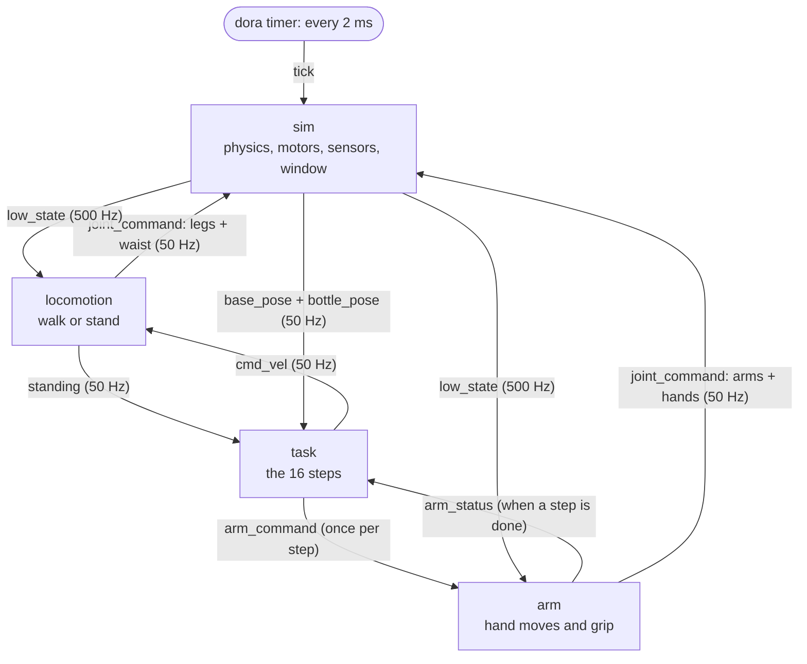
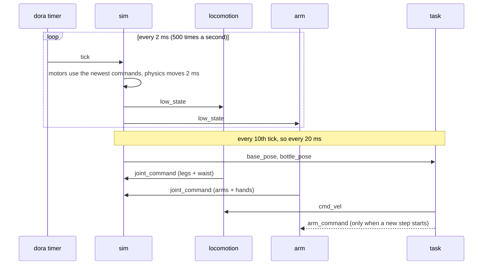

# The Unitree G1 picks up a bottle

A full humanoid robot, in a computer simulation, does one complete small job: it walks to a table, picks up a bottle, carries it to another table and puts it down on a green mark. Nothing is faked. The walking, the balance, the grasp and the bottle are all real physics.


**Video of one run, 2× speed:** [media/mission.mp4](media/mission.mp4)

> **Tell the robot what to do.** This lesson also runs with a head camera, an object detector, a
> memory, reusable skills and Claude as the brain: you type a sentence, the robot does it. See
> [../tell-the-robot/README.md](../tell-the-robot/README.md). With that work the mission has 17
> steps (the arm goes down after stepping back), `task` gets `bottle_pose` from the camera, and
> `dataflow.yml` has 9 nodes. The sections below describe the original 16-step, 4-node version.

This README explains everything: what every part does, every number in the code and where it comes from, and every chart. It is written for beginners, so you need no robotics or Python knowledge. Hard words are explained in the [glossary](#23-glossary) at the end.

The charts are drawn by `tools/make_charts.py` from the project's own code and from one real simulation run, so they always match the code.

## Contents

1. [Run it](#1-run-it)
2. [What the robot does](#2-what-the-robot-does)
3. [The big picture](#3-the-big-picture)
4. [Where everything lives](#4-where-everything-lives)
5. [Units and words](#5-units-and-words)
6. [The room](#6-the-room)
7. [The robot](#7-the-robot)
8. [How every motor is driven](#8-how-every-motor-is-driven)
9. [How the programs talk with dora](#9-how-the-programs-talk-with-dora)
10. [The messages](#10-the-messages)
11. [The simulator](#11-the-simulator)
12. [Walking with the trained network](#12-walking-with-the-trained-network)
13. [Standing still and balancing](#13-standing-still-and-balancing)
14. [Walking to a spot](#14-walking-to-a-spot)
15. [Inverse kinematics](#15-inverse-kinematics)
16. [Moving the arm and the hand](#16-moving-the-arm-and-the-hand)
17. [The mission in code](#17-the-mission-in-code)
18. [The four dora nodes](#18-the-four-dora-nodes)
19. [How we know it works](#19-how-we-know-it-works)
20. [The tools](#20-the-tools)
21. [What a real robot does differently](#21-what-a-real-robot-does-differently)
22. [Sources and licenses](#22-sources-and-licenses)
23. [Glossary](#23-glossary)

---

## 1. Run it

All commands start in the **top folder of the repository**, the one with `run.sh` in it. If you see "no such file or directory", type `pwd` to see where you are, then `cd` to the top folder.

### Watch it in a 3D window

```bash
./run.sh g1-pick-place
```

What happens:

- The first time, it installs MuJoCo and ONNX Runtime (`uv sync --extra sim`). That takes about a minute, once.
- A MuJoCo window opens with the robot and the two tables.
- The terminal prints each step, for example `step 3/16: move the open hand next to the bottle`. Every 10 seconds it also prints `running at 100% of real time`.
- After about 43 seconds it prints `done: the bottle stands 1.0 cm from the mark`. The robot keeps standing. Press **Ctrl-C** to stop everything.

In the window you can:

- **turn the view:** drag with the left mouse button. **Zoom:** scroll. **Move the view:** drag with the right mouse button.
- **push the robot or the bottle:** double-click a part, then hold **Ctrl** and drag with the right mouse button. Push it while it walks and watch it catch itself.
- **Backspace** resets only the physics, not the other three programs. To start over, press Ctrl-C and run the command again.

### Check it without a window

```bash
cd humanoid/03-g1-pick-place
uv run python tests/test_mission.py
```

This runs the same mission about 20 times faster than real time (the 42 s mission takes about 2 seconds) and ends with **PASS** or **FAIL**. Run it after every change.

### Redraw the charts in this README

```bash
cd humanoid/03-g1-pick-place
uv run python tools/make_charts.py
```

---

## 2. What the robot does


The task is 16 steps, done one after another. Blue steps walk, teal steps move the arm, orange steps open or close the hand.

| # | Step | What happens | It is done when |
|---|---|---|---|
| 1 | walk to table A | walks to the spot from where the bottle is 30 cm ahead and 12 cm to the right | the robot stands still within 8 cm of that spot |
| 2 | raise the hand | lifts the right hand up in front of the chest, behind the table edge | the arm says "done" |
| 3 | move the open hand next to the bottle | the open hand moves over the table to 8 cm right of the bottle | the arm says "done" |
| 4 | move the hand around the bottle | the hand slides 8 cm to the left until the palm touches the bottle | the arm says "done" |
| 5 | close the hand | fingers and thumb curl around the bottle (takes 1 s) | the hand is closed |
| 6 | lift the bottle | the hand goes straight up 10 cm | the arm says "done" |
| 7 | hold it close | brings the bottle closer to the body, for walking | the arm says "done" |
| 8 | step back | walks 50 cm backwards, away from table A | the robot stands still |
| 9 | walk to table B | walks to the spot in front of the mark, turning 90° on the way | the robot stands still |
| 10 | move the bottle over the mark | moves the hand so the bottle is right above the mark | the arm says "done" |
| 11 | put it down | lowers until the bottle's bottom is 5 mm above the table | the arm says "done" |
| 12 | open the hand | the fingers open (1 s); now the bottle stands on the table | the hand is open |
| 13 | pull the hand away | moves the hand 8 cm to the right, away from the bottle | the arm says "done" |
| 14 | raise the hand | back up in front of the chest | the arm says "done" |
| 15 | arm down | back to the walking pose | the arm says "done" |
| 16 | step back | walks 50 cm back from table B | the robot stands still |

In the run behind the chart: walking to table A took 6.4 s, grasping and lifting took until 15.0 s, walking to table B until 29.4 s, putting the bottle down until 37.9 s, and everything was done at 42.3 s. The bottle ended 0.9 cm from the center of the mark.

---

## 3. The big picture

The software is **four separate programs** that run at the same time. Each one has one job. They talk only by sending messages through **dora**, a framework that starts the programs and carries their messages.



| Program (node) | Its job | On a real G1 this would be |
|---|---|---|
| `sim` | the physics (MuJoCo), the motor drivers, the sensors, the 3D window | the robot itself |
| `locomotion` | walks (with Unitree's trained network) or stands still and balances | Unitree's walking controller |
| `arm` | moves the right hand smoothly, opens and closes it | an arm controller |
| `task` | the 16 steps: decides what to do next | a mission planner |

Read the drawing from top to bottom. `task` decides **what** to do. `locomotion` and `arm` decide **how to move the joints**. `sim` is the robot that **does it**. Commands go down; what the robot senses goes up.

**Why four programs instead of one?** Real robots are built like this, for four reasons:

- **A crash stays small.** If the arm program crashes, the legs keep balancing.
- **Parts can be swapped.** Put the real G1's driver where `sim` is, and the other three programs don't change.
- **Any language, any speed.** Each program can be written in its own language and run at its own rate.
- **Any computer.** A heavy program can run on another machine, with the same code.

---

## 4. Where everything lives

```
humanoid/03-g1-pick-place/
├── README.md                  this file
├── dataflow.yml               the dora file: which programs run and how they are wired
├── nodes/                     the 4 dora programs, each named like its node
│   ├── sim.py
│   ├── locomotion.py
│   ├── arm.py
│   └── task.py
├── g1/                        the robot software: plain Python, knows nothing about dora
│   ├── robot.py               joint names, poses, motor gains
│   ├── messages.py            the layout of every message
│   ├── simulator.py           MuJoCo world + motor drivers + sensors
│   ├── locomotion.py          walking network + standing balance
│   ├── navigation.py          "go to this spot" -> walking speed
│   ├── arm_ik.py              inverse kinematics for the arm
│   ├── arm.py                 smooth arm moves, gravity compensation, the grip
│   └── mission.py             the 16 steps
├── robot/                     the robot model and the room (MuJoCo files), see robot/README.md
│   ├── scene.xml              the room: floor, tables, bottle, mark (it includes the robot)
│   ├── g1_with_hands.xml      the Unitree G1 with both hands
│   └── assets/                3D shapes of the robot parts
├── policies/                  Unitree's walking network, see policies/README.md
│   └── g1_walk.onnx
├── tests/test_mission.py      the whole mission without dora: PASS or FAIL
├── tools/
│   ├── export_walk_policy.py  rebuilds policies/g1_walk.onnx from Unitree's file
│   └── make_charts.py         draws the charts in this README
└── media/                     pictures, charts and the video for this README
```

### Who loads what

| Node | Program | Uses this class | Which loads | Setting in `dataflow.yml` |
|---|---|---|---|---|
| `sim` | `nodes/sim.py` | `Simulator` (`g1/simulator.py`) | `robot/scene.xml` | `SCENE` |
| `locomotion` | `nodes/locomotion.py` | `Locomotion` (`g1/locomotion.py`) | `policies/g1_walk.onnx` | `POLICY` |
| `arm` | `nodes/arm.py` | `ArmController` (`g1/arm.py`) | `robot/g1_with_hands.xml` | `ROBOT` |
| `task` | `nodes/task.py` | `Mission` (`g1/mission.py`) | no file: the room's numbers come as settings | `PLACE_POINT`, `PICK_HEADING_DEG`, `PLACE_HEADING_DEG`, `TABLE_HEIGHT` |

Three simple rules:

- **Code and data are apart.** `nodes/` and `g1/` are code. `robot/` and `policies/` are data files that the code loads.
- **Names match.** Each node in `dataflow.yml` has a program file with the same name: the node `arm` runs `nodes/arm.py`.
- **The logic is a library.** All the robot logic is in `g1/`, as normal Python classes. The nodes in `nodes/` only turn messages into calls on these classes, and the answers back into messages. This is why the test can run the same classes without dora, why the same code could talk to the real robot one day, and why each file has only one job.

---

## 5. Units and words

| Unit | What it means | Example in this project |
|---|---|---|
| m, cm, mm | meter. 1 m = 100 cm = 1000 mm | the tables are 0.80 m high |
| kg | kilogram, the mass of something | the robot is 34.4 kg |
| s, ms | second, millisecond. 1 s = 1000 ms | one physics step is 2 ms |
| Hz | "times per second" | 500 Hz = 500 times a second |
| rad | radian, a unit for angles. 1 rad = 57.3°, a full turn = 6.28 rad (2π) | when standing, the knee is bent 0.4 rad = 23° |
| rad/s | how fast a joint turns | the shoulder turned at 0.72 rad/s |
| N | newton, a force. Gravity pulls 1 kg with 9.81 N | the robot's arm weighs 39.7 N |
| Nm | newton-meter, a turning force (torque): force × lever | 10 N pushing 0.1 m from a joint = 1 Nm |
| Nm/rad | stiffness: how many Nm of push per radian of error | the knee's stiffness is 150 Nm/rad |

**Why radians and not degrees?** The math of turning is simplest in radians: a wheel of radius 1 m that turns 1 rad rolls exactly 1 m. MuJoCo, and almost all robot software, uses radians.

**Directions.** x points forward, y points left, z points up. The **world frame** is fixed to the room: the robot starts at x = 0, y = 0 looking along +x. The **body frame** is fixed to the robot's pelvis: x is always the robot's own forward, so it turns when the robot turns.

**Pitch, roll, yaw** are the three ways to turn:

- **pitch**: tipping forward and back, like nodding "yes"
- **roll**: tipping to the side, like tilting your head to your shoulder
- **yaw**: turning left and right, like shaking your head "no"

A joint called "hip pitch" swings the leg forward and back; "waist yaw" turns the upper body left and right.

---

## 6. The room

File: `robot/scene.xml`


The map shows the room from above and the **real path** the robot's pelvis took in one run: blue while walking to the bottle, orange while carrying it, teal after letting go. The line wiggles because the robot sways from one foot to the other while it walks.

| Thing | Number | Why this number |
|---|---|---|
| physics step | 2 ms (500 steps per second) | the rate of the G1's motor loop; small enough that contacts stay stable |
| robot start | x = 0, y = 0, facing +x | the origin of the room |
| table A | top 0.6 m × 0.8 m, surface 0.80 m high, front edge at x = 1.3 m | 0.80 m is the height where the G1's right hand grasps best (section 15) |
| table B | top 0.8 m × 0.6 m, surface 0.80 m high, front edge at y = −1.4 m | same height as table A |
| bottle | 6 cm wide, 18 cm tall (15 cm body + 3 cm cap), 0.35 kg (0.33 + 0.02) | a small 0.33 l water bottle, narrow enough for a three-finger hand |
| bottle start | x = 1.42, y = 0; its middle 0.875 m high | 12 cm from table A's edge; middle = table 0.80 + half the body 0.075 |
| green mark | x = 1.0, y = −1.52 on table B | 12 cm from table B's front edge; it is only drawn, nothing can touch it |
| friction | tables 0.8, bottle 1.0, robot feet 0.6 | like wood, plastic and rubber |
| distances walked | 1.1 m to table A; 1.4 m from the step-back spot to table B | follow from where the tables stand |

---

## 7. The robot

Files: `robot/g1_with_hands.xml` (the model), `g1/robot.py` (its numbers in Python)


The Unitree G1 is 1.32 m tall. In this model, with both hands, it weighs **34.4 kg**. It has **43 motors**:

| Group | Joints | Positions in `robot.JOINTS` | Their job here |
|---|---|---|---|
| legs | 12: per leg hip pitch, hip roll, hip yaw, knee, ankle pitch, ankle roll | 0–11 | walk and stand |
| waist | 3: yaw, roll, pitch | 12–14 | held straight |
| left arm | 7: shoulder pitch, roll, yaw, elbow, wrist roll, pitch, yaw | 15–21 | holds its walking pose |
| left hand | 7: thumb (3 joints), middle finger (2), index finger (2) | 22–28 | stays open |
| right arm | 7, like the left | 29–35 | does all the arm work |
| right hand | 7, like the left | 36–42 | grasps the bottle |

**Where the model comes from:** MuJoCo Menagerie, the collection of robot models kept by the MuJoCo team. They made it from Unitree's own robot files. We changed three things (details in `robot/README.md`): the motors take torque like the real G1's motors, we removed a start pose that only made sense for the old motors, and we marked a grasp point in the middle of each hand.

**How strong each motor is** (its torque limit, from the model): hip pitch and yaw 88 Nm, hip roll and knee 139 Nm, ankles 50 Nm, waist yaw 88 Nm, waist roll and pitch 50 Nm, shoulders, elbows and wrist roll 25 Nm, wrist pitch and yaw 5 Nm, thumb base 2.45 Nm, all other finger joints 1.4 Nm. Every joint also has a little friction (0.3 Nm) and motor inertia ("armature" 0.01), as in the real robot.

### The numbers in `g1/robot.py`

**`JOINTS`** is the list of all 43 joint names, in the order of the model file. Every message that carries joint values uses this order, so position 3 is always the left knee. **`NUM_JOINTS`** = 43.

**The groups** (`LEGS = slice(0, 12)` and so on) say which positions belong to which body part. `slice(0, 12)` means "positions 0 up to, but not including, 12". `LOWER_BODY` (legs + waist, positions 0–14) is what the locomotion program commands; `UPPER_BODY` (arms + hands, positions 15–42) is what the arm program commands.

**`STAND_LEGS = [-0.2, 0, 0, 0.4, -0.2, 0]`** for each leg (hip pitch, hip roll, hip yaw, knee, ankle pitch, ankle roll), in radians. This is the standing pose. Why these values:

- −0.2 + 0.4 − 0.2 = 0, so the thigh and shin tilts cancel: the pelvis stays level and the feet stay flat.
- With this knee bend, the robot's center of mass sits **2.1 cm in front of the ankles**, over the middle of the foot. The foot reaches from 5 cm behind the ankle to 12 cm in front, so 2.1 cm is safely inside.

**`LEFT_ARM_WALK = [0, 0.15, 0, 1.2, 0, 0, 0]`** and **`RIGHT_ARM_WALK = [0, -0.15, 0, 1.2, 0, 0, 0]`**: the arm pose while walking. Why:

- Unitree trained its walking network on a G1 with fixed arms and light hands. Our Dex3 hands add 2.3 kg, which moved the center of mass 1.3 cm forward, and the robot crept forward when told to stand still. With the elbows at 1.2 rad, the center of mass is back where it was in training: 4.6 cm in front of the ankles (section 12).
- The hands hang low (0.57 m), below any table top, so the robot can walk up to a table.
- Shoulder roll ±0.15 rad keeps the arms a little away from the thighs.

**`RIGHT_HAND_OPEN = [0, 0.5, 0, 0, 0, 0, 0]`** (thumb 0, 1, 2, middle 0, 1, index 0, 1): fingers straight, the thumb swung 0.5 rad back toward the wrist so it is out of the way. **`RIGHT_HAND_CLOSED = [0, -0.3, -1.2, 1.3, 1.3, 1.3, 1.3]`**: fingers and thumb curled further than the bottle allows, so the motors keep squeezing (section 16). The left hand is the mirror image, so its values are the same with the opposite sign.

**The gains** (stiffness KP in Nm/rad, damping KD in Nm per rad/s; section 8 explains them):

| Name | Values | Where they come from, and why |
|---|---|---|
| `LEG_KP`, `LEG_KD` | hips 100, knees 150, ankles 40; KD 2, 4, 2 | Unitree's training settings for the walking network (`unitree_rl_gym`, `g1.yaml`). The network only works with exactly these |
| `STAND_LEG_KP`, `STAND_LEG_KD` | hips 150, knee 225, ankles 250; KD 4, 8, 8 | ours, for standing: stiffer, because a standing robot is an upside-down pendulum that needs strong ankles (section 13) |
| `WAIST_KP`, `WAIST_KD` | 300; KD 6 | Unitree's real-robot value is KP 300, KD 3. We use KD 6: the real motor's gearbox adds damping that the simulation lacks, and with 3 the torso twisted at every step |
| `ARM_KP`, `ARM_KD` | shoulder pitch and roll 100, shoulder yaw and elbow 50, wrists 20; KD 2, 2, 2, 2, 1, 1, 1 | Unitree's real-robot values (`unitree_rl_gym`, `deploy_real/configs/g1.yaml`) |
| `HAND_KP`, `HAND_KD` | 5; KD 0.1 | ours: a finger motor gives at most 1.4 Nm, and with KP 5 a target 0.3 rad past the bottle already asks for 5 × 0.3 = 1.5 Nm, the full squeeze |

---

## 8. How every motor is driven

File: `g1/simulator.py`, method `step()`

Every one of the 43 motors uses the same formula, 500 times a second:

```
torque = kp × (target − angle)  −  kd × speed  +  extra
```

The motor gets four numbers from the controllers: **target**, **kp**, **kd** and **extra**. It measures the other two itself: **angle** and **speed**. The real G1's motor drivers take exactly these four numbers (Unitree's `LowCmd` message), so the same controllers could later drive the real robot.

The formula has three parts:

- **`kp × (target − angle)`: the spring.** It pushes the joint toward the target, harder the farther away it is. kp is the stiffness: how many Nm for each radian of distance.
- **`− kd × speed`: the brake.** It pushes against the joint's own speed, harder the faster it turns. Without it the spring would overshoot and wobble, like a car without shock absorbers. kd says how many Nm for each rad/s.
- **`+ extra`: a known push.** A torque we already know is needed. For the arms it is the torque that holds up their weight, which MuJoCo computes. For the legs it is 0, because Unitree trained the walking network without it.

Finally the torque is clipped to the motor's limit (section 7), just like a real motor can't push harder than its maximum.

### One real motor, with real numbers

The right shoulder, 7.6 s into the run, while the arm raises the hand:

| Input | Value | Where it comes from |
|---|---|---|
| target | 0.750 rad | the arm program's target for this moment of the move |
| angle | 0.727 rad | measured by the joint's sensor |
| speed | 0.719 rad/s | measured by the joint's sensor |
| kp | 100 Nm/rad | Unitree's value for this motor on the real G1 |
| kd | 2 Nm per rad/s | Unitree's value for this motor on the real G1 |
| extra | 1.50 Nm | MuJoCo: what holds up the arm in this pose (below) |

- spring: 100 × (0.750 − 0.727) = **+2.30 Nm**. The shoulder is 0.023 rad behind its moving target, so the spring pushes it on.
- brake: − 2 × 0.719 = **−1.44 Nm**. It is turning at 0.72 rad/s, so the brake holds it back from overshooting.
- known push: **+1.50 Nm** for the arm's weight, so the spring only has to do the moving.
- total: 2.30 − 1.44 + 1.50 = **2.36 Nm**.

**Why the target is 0.750 and the speed about 0.72.** All 7 arm joints move together and arrive at the same moment. The elbow has the longest way to go (1.64 rad), so it moves at the full 1 rad/s; the shoulder only needs 1.24 rad, so its planned speed is 1.24 ÷ 1.64 = 0.76 rad/s. The measured 0.719 is close to that.

### Where the 1.50 Nm comes from: weight × lever


It is the same rule as holding a bag: **torque = weight × lever**.

- **Weight.** The shoulder carries everything after it: upper arm, forearm, wrist and hand. In the robot model that is 4.046 kg, and 4.046 × 9.81 = **39.7 N**.
- **Lever.** Only the sideways distance between the arm's center of mass and the shoulder's axis counts. At 7.6 s the elbow is swinging back while the hand comes up in front, so the arm's center of mass sits 3.9 cm behind the shoulder. The G1's shoulder axis is built in tilted by 16°, which leaves 3.9 × cos 16° = **3.79 cm**.
- **Torque:** 39.7 N × 0.0379 m = **1.50 Nm**.

MuJoCo does this sum for every part of the arm, 50 times a second. The same joint at other moments of the same move:

| Time | Arm's center of mass vs. shoulder | extra |
|---|---|---|
| 6.4 s | 3.9 cm in front | −1.47 Nm |
| 7.1 s | almost straight below | +0.11 Nm |
| 7.6 s | 3.9 cm behind | +1.50 Nm |
| 8.5 s | 7.0 cm behind | +2.68 Nm |

The arm hanging straight down needs almost nothing; the farther its weight sticks out, the more torque it needs. The minus sign only means the motor pushes the other way.

**What if the extra push were missing?** A spring only pushes when it is stretched, so the arm would sag until the spring's error makes the needed torque. At the elbow holding the bottle (3.3 Nm of weight, kp 50) that is 3.3 ÷ 50 = 0.065 rad, about 2 cm lower at the hand.

---

## 9. How the programs talk with dora

Files: `dataflow.yml`, `nodes/*.py`

dora is a framework that connects the programs of a robot. ROS 2 is the best-known framework of this kind; dora is a newer and faster one. dora does three things:

1. **You describe the graph** in one file, `dataflow.yml`: which programs run, and which output goes to which input.
2. **dora starts the programs**, each as its own process, with its own settings.
3. **dora carries the messages.** When a program sends an output, every program that listed it as an input gets it.

Think of a small factory. Each workstation does one job, and conveyor belts carry parts between them. The workstations are the nodes, the belts are the connections, and the floor plan is `dataflow.yml`.

### 9.1 Eight words to know

| Word | Meaning | In this project |
|---|---|---|
| dataflow | the whole graph: which programs run and how they are wired | written in `dataflow.yml`: 4 nodes, 10 wires, 1 timer |
| node | one program in the graph, with one job | `sim`, `locomotion`, `arm`, `task` |
| output | a named stream of messages that a node sends | `sim` sends `low_state` |
| input | a named stream a node receives, wired to another node's output | `locomotion` gets `low_state` from `sim` |
| message | one piece of data on a stream; in dora an Arrow array, here a list of numbers | one `low_state` is 94 numbers |
| event | what a node's loop receives: INPUT (a message arrived) or STOP (time to quit) | 500 `low_state` events per second |
| timer | an input that dora itself sends at a fixed rate | `dora/timer/millis/2`, a tick every 2 ms |
| daemon | dora's helper program: it starts the nodes, runs the timers, stops everything | `dora run` starts one for us |

### 9.2 `dataflow.yml`, part by part

The file starts with two settings for the whole graph:

```yaml
strict_types: true   # a type mismatch between two nodes is an error

env:                 # given to every node
  PYTHONPATH: .      # so every node can `import g1`
```

- **`strict_types: true`**: every output says what kind of data it carries (`output_types`, below). With this setting, dora refuses to start if two ends of a wire don't agree, instead of only printing a warning.
- **`env`** at the top: settings (environment variables) that every node gets. `PYTHONPATH: .` tells Python to also look for code in this folder, so every node can write `from g1 import robot`.

Then comes one entry per node. Here is the real entry for `sim`:

```yaml
  - id: sim
    name: robot + room
    description: MuJoCo physics at 500 Hz, the G1's motor drivers and sensors, 3D window.
    path: uv
    args: run --no-sync mjpython -u nodes/sim.py
    inputs:
      tick: dora/timer/millis/2              # one physics step every 2 ms
      lower_body_cmd: locomotion/joint_command
      upper_body_cmd: arm/joint_command
    outputs:
      - low_state                            # joint angles and speeds, IMU
      - base_pose                            # where the robot is
      - bottle_pose                          # where the bottle is
    output_types:
      low_state: std/core/v1/Float64
      base_pose: std/core/v1/Float64
      bottle_pose: std/core/v1/Float64
    env:
      SCENE: robot/scene.xml
```

| Key | What it means |
|---|---|
| `id` | the node's name. Other nodes use it in their wires, like `sim/low_state` |
| `name`, `description` | notes for humans; `dora graph` shows them |
| `path`, `args` | the command dora runs to start the node. Here: `uv run --no-sync mjpython -u nodes/sim.py`. `uv` runs Python from the project's environment, `--no-sync` skips reinstalling packages, `mjpython` is the Python that MuJoCo's window needs on a Mac (the other nodes use plain `python`), `-u` prints log lines immediately |
| `inputs` | what the node receives, written `name: node/output`. The name before the colon is what the node's code sees |
| `outputs` | what the node sends. Any other node may wire these to its inputs |
| `output_types` | what each output carries: `std/core/v1/Float64` means "an array of decimal numbers (64-bit floats)" |
| `env` | settings for this node only. `SCENE` tells `nodes/sim.py` which room file to load |

**How a wire is written.** Take `cmd_vel: task/cmd_vel` in the `locomotion` node. Read it left to right: the input named `cmd_vel`, inside `locomotion`, comes from the node `task`, from its output named `cmd_vel`. Four things follow from this:

- **The wire is written only at the receiver.** The sender just lists its outputs and doesn't know who listens. You can add a new listener (for example a plotting node) without touching the sender.
- **One output can feed many inputs.** `sim/low_state` goes to both `locomotion` and `arm`.
- **dora itself can be the sender.** `tick: dora/timer/millis/2` gives `sim` a tick every 2 ms: 500 per second.
- **The two names don't have to match.** `sim` calls its input `lower_body_cmd`; the output it comes from is called `joint_command`.

All wires of the graph:

| Node | Inputs (name: from) | Outputs | Settings (`env`) |
|---|---|---|---|
| `sim` | `tick: dora/timer/millis/2`, `lower_body_cmd: locomotion/joint_command`, `upper_body_cmd: arm/joint_command` | `low_state`, `base_pose`, `bottle_pose` | `SCENE` |
| `locomotion` | `low_state: sim/low_state`, `cmd_vel: task/cmd_vel` | `joint_command`, `standing` | `POLICY` |
| `arm` | `low_state: sim/low_state`, `arm_command: task/arm_command` | `joint_command`, `arm_status` | `ROBOT` |
| `task` | `base_pose: sim/base_pose`, `bottle_pose: sim/bottle_pose`, `standing: locomotion/standing`, `arm_status: arm/arm_status` | `cmd_vel`, `arm_command` | `PICK_HEADING_DEG`, `PLACE_POINT`, `PLACE_HEADING_DEG`, `TABLE_HEIGHT` |

### 9.3 What happens when you start it

1. **`./run.sh g1-pick-place`** installs what is missing, goes to this folder, and runs `dora run dataflow.yml`.
2. **dora reads `dataflow.yml`** and checks it: every input must point to an output that exists, and every wire must carry the declared type.
3. **dora starts its daemon**, the helper program that starts the nodes, runs the timers and stops everything.
4. **The 4 programs start.** For each node dora runs its `path` + `args`, with its `env` settings.
5. **Each program calls `Node()`**, which connects it to dora. Now it can receive events and send outputs.
6. **The timer starts ticking.** Every 2 ms `sim` gets a tick and sends the robot's state. The physics starts moving only when both `locomotion` and `arm` have sent their first command, like a real robot that waits for its controller.
7. **Ctrl-C:** dora sends STOP to every node, each program's loop ends, and the programs exit. `dora run` also saves each node's log in `out/<run id>/log_<node>.jsonl`.

### 9.4 Inside a node: the event loop

Every dora node in Python has the same shape. This is the `locomotion` node, a little shortened:

```python
node = Node()                                  # 1
for event in node:                             # 2
    if event["type"] == "STOP":                # 3
        break
    if event["id"] == "cmd_vel":               # 4
        cmd_vel = event["value"].to_numpy()    # 5
    elif event["id"] == "low_state":
        state = event["value"].to_numpy()
        if state[0] < next_update:             # 6
            continue
        next_update = state[0] + 0.02
        target, kp, kd = locomotion.update(...)
        node.send_output("joint_command", ...) # 7
```

1. `Node()` connects this program to dora.
2. The `for` loop hands the program one event at a time. Between events the program just sleeps and uses no computer time.
3. A STOP event means quit (for example after Ctrl-C): leave the loop, and the program ends.
4. `event["id"]` says which input arrived: the names written in `dataflow.yml`.
5. `event["value"]` is the message, an Arrow array. `.to_numpy()` turns it into a numpy array that points at the same memory, so nothing is copied.
6. `low_state` arrives 500 times a second, but the walking network runs every 20 ms of robot time. The first number of the message is the robot's clock, so the node skips messages until 20 ms have passed: it uses 1 message in 10.
7. `send_output` sends the answer. dora delivers it to every node that listed it as an input: here, `sim`.

### 9.5 How messages travel between programs

There are two kinds of traffic:

- **Control traffic goes through the dora daemon:** starting the nodes, the timer ticks, and STOP at the end.
- **The data goes straight from the sending node to every receiving node.** dora 1.1 uses a networking library called Zenoh for this.

Four facts about the data (checked in dora 1.1's source code):

| Fact | Details |
|---|---|
| Small messages are copied | Under 4 KB a message is simply copied. All of ours are small: one `low_state` is 94 numbers × 8 bytes = 752 bytes |
| Big messages use shared memory | From 4 KB up (for example a camera image), the message is written once into a piece of memory that both programs can see. The receiver reads it without a copy. This is why dora is fast with images |
| Every input has a waiting line of 10 | If a node is too slow, messages wait. When 10 are waiting, the oldest is thrown away and dora warns: `Discarding event for input ... due to queue size limit`. So a slow node never blocks the others |
| It works across computers | Because the data goes through a network library, the same dataflow can be spread over several computers without changing the node code |

### 9.6 One loop of the robot



**The fast loop, 500 times a second**, belongs to `sim`. The timer sends a tick; `sim` applies the newest command to each motor (section 8), moves the physics forward 2 ms, and sends the new `low_state`.

**The slow loop, 50 times a second**, belongs to the controllers:

- `locomotion` runs the walking network (or the balance) and sends the leg and waist commands.
- `arm` moves the hand a little further along its path and sends the arm and hand commands.
- `task` checks the mission and sends a walking speed, and, when a new step starts, an arm command.

`sim` uses the new commands from its next tick on. So between two commands, the motor formula runs 10 times with the same targets. The real G1 works the same way: fast motor loops inside the motors, slower controllers outside.

| Message | From → to | How often |
|---|---|---|
| `tick` | dora → `sim` | 500 Hz |
| `low_state` | `sim` → `locomotion`, `arm` | 500 Hz |
| `base_pose`, `bottle_pose` | `sim` → `task` | 50 Hz |
| `joint_command` (legs + waist) | `locomotion` → `sim` | 50 Hz |
| `joint_command` (arms + hands) | `arm` → `sim` | 50 Hz |
| `standing` | `locomotion` → `task` | 50 Hz |
| `cmd_vel` | `task` → `locomotion` | 50 Hz |
| `arm_command` | `task` → `arm` | once per arm step |
| `arm_status` | `arm` → `task` | once, when an arm step is done |

### 9.7 Two clocks: wall time and robot time

- **Wall time drives the physics.** The timer ticks every 2 ms of real time, and each tick is one 2 ms physics step. So the robot moves at its real speed.
- **Robot time drives the controllers.** Every `low_state` starts with the simulator's clock. `locomotion`, `arm` and `task` count 20 ms on that clock, not on the wall clock. So even if the computer stutters for a moment, they still run exactly once every 10 physics steps.
- **If the computer is too slow,** ticks wait in `sim`'s waiting line (10 places) and the extra ones are dropped. The robot then runs slower than real time, but nothing breaks. `sim` prints its speed every 10 s of robot time; on this Mac it says `running at 100% of real time`.
- **At start-up,** the physics waits until `locomotion` and `arm` have both sent a first command. Until then the clock stays at 0.

### 9.8 dora commands worth knowing

| Command | What it does | When |
|---|---|---|
| `dora run dataflow.yml` | starts the whole dataflow here; Ctrl-C stops it | every day; `run.sh` uses it |
| `dora validate dataflow.yml` | checks every wire and type, without starting anything | after you edit the YAML |
| `dora graph dataflow.yml --open` | draws the graph in your browser | to see who talks to whom |
| `dora logs` | shows what each node printed; after `dora run` it reads the `out/` folder | when something went wrong |
| `dora up`, `dora start`, `dora stop` | runs dora in the background and starts or stops dataflows there | for long runs, and for the next two |
| `dora topic echo`, `dora topic hz` | prints the messages of one output, or how often they come | to check one node's output |
| `dora top` | CPU and memory of every node, live | when something is slow |
| `dora record`, `dora replay` | saves all messages to a `.drec` file, and plays them back later | to debug without running the robot |

Try it now, from the top folder: `dora graph humanoid/03-g1-pick-place/dataflow.yml --open`

---

## 10. The messages

File: `g1/messages.py`


Every message in this project is **a plain list of decimal numbers**. The numbers carry no labels, so the sender and the receiver must agree on their order. That agreement is written in one place, `g1/messages.py`, the same idea as the message files in ROS. For each message there is a `pack_...` function that builds the list and an `unpack_...` function that splits it into named parts.

| Message | Numbers | What is inside, in order | From → to |
|---|---|---|---|
| `low_state` | 94 | time, 43 joint angles, 43 joint speeds, pelvis orientation (4), pelvis turn rates (3) | `sim` → `locomotion`, `arm` |
| `joint_command`, legs + waist | 60 | 15 targets, 15 kp, 15 kd, 15 extra torques | `locomotion` → `sim` |
| `joint_command`, arms + hands | 112 | 28 targets, 28 kp, 28 kd, 28 extra torques | `arm` → `sim` |
| `base_pose`, `bottle_pose` | 8 | time, x, y, z, orientation (4) | `sim` → `task` |
| `cmd_vel` | 3 | forward speed (m/s), sideways speed (m/s), turn speed (rad/s), in the robot's own frame | `task` → `locomotion` |
| `standing` | 1 | 1 = standing still and steady, 0 = not | `locomotion` → `task` |
| `arm_command` | 6 | id, kind of command, x, y, z, heading | `task` → `arm` |
| `arm_status` | 2 | id of the finished command, 1 = ok / 0 = failed | `arm` → `task` |

The functions:

- **`pack_low_state(time, q, dq, quat, gyro)`** glues the five parts into one list of 94 numbers. **`unpack_low_state(msg)`** cuts it back: position 0 is the time, 1–43 the angles, 44–86 the speeds, 87–90 the orientation, 91–93 the turn rates.
- **`pack_joint_command(target, kp, kd, tau)`** glues four equal-length lists. **`unpack_joint_command(msg)`** splits the list into 4 equal parts. Because the length tells how many joints there are, the same functions work for the 15 lower-body and the 28 upper-body joints.
- **`pack_pose(time, position, quat)`** and **`unpack_pose(msg)`**: 1 + 3 + 4 numbers. The time stamp says when the pose was measured, like a ROS "stamped" message.
- **`pack_arm_command(command_id, kind, position, yaw)`** and **`unpack_arm_command(msg)`**: the id lets the task tell which command a reply belongs to. The kinds are numbered:

| Kind | Number | What the arm does |
|---|---|---|
| `REST` | 0 | joint move back to the walking pose |
| `MOVE_JOINTS` | 1 | joint move to a hand position (big moves through free space) |
| `MOVE_LINE` | 2 | straight-line move to a hand position (moves near objects) |
| `OPEN` | 3 | open the hand |
| `CLOSE` | 4 | close the hand |

- **`pack_arm_status(command_id, ok)`** and **`unpack_arm_status(msg)`**: "command number `id` is finished", and whether it worked.

dora sends each list in the **Arrow** format, a standard way to lay out numbers in memory that Python, Rust and C++ all read directly, without converting.

---

## 11. The simulator

File: `g1/simulator.py`

The `Simulator` class is the robot and the room. On the real robot, each motor has a small computer (the motor driver) that turns a command into torque thousands of times a second. Here the simulator plays that part, once per 2 ms physics step, and also plays the sensors. The rest of the software sends the same commands it would send to the real G1.

**What is a quaternion?** MuJoCo stores how something is turned in space as 4 numbers (w, x, y, z), called a quaternion. You don't need the math; two facts are enough:

- not turned at all: (1, 0, 0, 0)
- turned by an angle a around the vertical axis: (cos(a/2), 0, 0, sin(a/2))

### `yaw_of(quat)`

Gives the heading (which way the robot faces on the floor, in radians) from a quaternion:

```
heading = atan2(2·(w·z + x·y), 1 − 2·(y² + z²))
```

For a pure turn by an angle a this gives back exactly a. `atan2` is a function that turns an "up" and an "across" amount into an angle, in every direction.

### `Simulator.__init__(scene_path, start)`

1. Loads the room file (`robot/scene.xml`, which includes the robot) into MuJoCo: `model` is the fixed description, `data` is the changing state.
2. Builds three lookup lists, so the rest of the code can use the order of `robot.JOINTS`:
   - `qpos_index`: where each joint's angle is in MuJoCo's list of positions,
   - `dof_index`: where its speed is in MuJoCo's list of speeds,
   - `motor_index`: which motor drives it. The motors of the right hand's fingers are listed in a different order than its joints, so they are looked up by name, never by position.
3. Reads each motor's torque limit, finds the pelvis gyro sensor (`imu-pelvis-angular-velocity`) and where the bottle's position is stored.
4. Sets all motor commands to zero (motors off), then puts the robot in place with `_stand_at`.

### `_stand_at(x, y, heading)`

Puts the robot in its standing pose at a spot on the floor:

1. Builds the pose: legs `STAND_LEGS`, arms in their walking pose, hands open.
2. Places the pelvis at (x, y), 1 m high, turned by `heading` (quaternion cos(h/2), 0, 0, sin(h/2)).
3. Lets MuJoCo compute where every part is. Each foot touches the floor with 4 small balls (5 mm radius); the code finds the lowest one and lowers the whole robot until it just touches the floor. So the robot starts standing, not falling.
4. Sets the motors to hold this pose with the standing gains, until the controllers send their first commands.

### `set_command(group, target, kp, kd, tau)`

Stores new motor commands for a group of joints (for example `robot.LOWER_BODY`). `tau` is the extra torque; if none is given it is 0.

### `step()`

The motor drivers and the physics, for 2 ms:

1. Reads all joint angles and speeds.
2. For every motor: `torque = kp × (target − angle) − kd × speed + extra` (section 8).
3. Clips each torque to its motor's limit.
4. Hands the torques to MuJoCo and moves the physics forward one step (`mj_step`, 2 ms).

### The sensors

| Method | Returns | On the real robot this comes from |
|---|---|---|
| `time` | the simulator's clock, in seconds | the robot's clock |
| `joint_state()` | 43 angles (rad) and 43 speeds (rad/s), in `robot.JOINTS` order | the joint encoders |
| `imu()` | pelvis orientation (quaternion) and turn rates (rad/s) | the IMU in the pelvis (Unitree's walking network uses the pelvis IMU) |
| `base_pose()` | pelvis position (x, y, z) and orientation in the room | localization: lidar plus a map |
| `bottle_pose()` | bottle position and orientation | a camera plus an object detector |

The last two are shortcuts: the simulator simply knows where things are. A real robot has to work them out (section 21).

---

## 12. Walking with the trained network

File: `g1/locomotion.py` (the `WalkPolicy` class), `policies/g1_walk.onnx`

The legs are not programmed step by step. They are driven by a small **neural network** that Unitree trained and published (repository `unitree_rl_gym`). A trained network that controls a robot is called a **policy**.

**How Unitree trained it.** With reinforcement learning in a simulator (Isaac Gym): thousands of simulated G1s tried to walk at random speeds. Their behavior was scored (followed the wanted speed? body upright and at the right height? stepping in rhythm? not fallen?), and the network was adjusted again and again toward higher scores. We only use the finished network. It is stored as an ONNX file, the standard format for running trained networks on robots (see `policies/README.md`).

**What it does, every 20 ms:** it gets 47 numbers about the robot and the wanted speed, and answers with 12 numbers: one target angle for each leg joint.

### The 47 inputs

| Numbers | What | Scaled by |
|---|---|---|
| 3 | how fast the pelvis turns (gyro), rad/s | × 0.25 |
| 3 | which way gravity points, seen from the pelvis | (already between −1 and 1) |
| 3 | the wanted speed: forward, sideways (m/s), turn (rad/s) | × 2, × 2, × 0.25 |
| 12 | the leg angles, minus the pose it was trained around | × 1 |
| 12 | the leg speeds, rad/s | × 0.05 |
| 12 | its own previous answer | (as it was) |
| 2 | where it is in the step rhythm, as sin and cos | (between −1 and 1) |

**Why the scaling?** During training, Unitree scaled every input so they are all about the same size, roughly between −1 and 1, because networks learn best that way. When we run the network we must scale exactly the same way, or it would "see" different numbers than the ones it learned with.

**Which way gravity points: `gravity_in_body(quat)`.** This tells the network how it leans, like your inner ear does. Upright, gravity points straight down in the pelvis' own frame: (0, 0, −1). Leaning forward by an angle a, it becomes (sin a, 0, −cos a). The function computes this from the pelvis quaternion:

```
gravity = ( 2·(w·y − z·x),  −2·(z·y + w·x),  1 − 2·(w² + z²) )
```

That is the bottom row of the pelvis' rotation matrix, with the sign flipped.

**The step rhythm.** `phase = (walk_time mod 0.8) / 0.8` counts from 0 to 1 in every 0.8 s step cycle (left step + right step). The network gets sin(2π·phase) and cos(2π·phase) instead of the phase itself: that is a point going around a circle, so there is no sudden jump when the phase goes from 1 back to 0.

**The answer.** `target = POLICY_LEGS + 0.25 × answer` for each of the 12 leg joints. An answer of 1 means "0.25 rad away from the trained pose". The targets go to the motors with Unitree's leg gains (section 7).

**The memory.** The network has a memory of 64 numbers (an LSTM). Each step it gets the old memory and returns a new one, so it remembers the last moments, like you feel how you are already moving. `reset()` clears the memory and the previous answer; the locomotion code calls it every time the robot starts walking again.

### `WalkPolicy.step(cmd_vel, leg_q, leg_dq, quat, gyro, walk_time)`

1. Works out the phase from `walk_time` (seconds since walking started).
2. Builds the 47 inputs in the order of the table, with the scaling.
3. Runs the network with ONNX Runtime: 47 inputs + old memory in, 12 answers + new memory out.
4. Remembers the answer (it is an input next time) and returns `POLICY_LEGS + 0.25 × answer`.

### The constants

All of these come from Unitree's settings file for running this network in MuJoCo (`unitree_rl_gym`, `deploy/deploy_mujoco/configs/g1.yaml`). The network was trained with exactly these numbers; changing them breaks it.

| Name | Value | Meaning |
|---|---|---|
| `POLICY_DT` | 0.02 s | the network runs every 20 ms, 50 times a second |
| `GAIT_PERIOD` | 0.8 s | one full step cycle, left + right |
| `POLICY_LEGS` | hip −0.1, 0, 0, knee 0.3, ankle −0.2, 0 (per leg) | the pose it was trained around |
| `ACTION_SCALE` | 0.25 | target = trained pose + 0.25 × answer |
| `CMD_SCALE` | 2, 2, 0.25 | scaling for forward, sideways and turn speed |
| `GYRO_SCALE` | 0.25 | scaling for the turn rates |
| `JOINT_SPEED_SCALE` | 0.05 | scaling for the leg speeds |
| `MEMORY_SIZE` | 64 | numbers in the network's memory |

### Two fixes, so our G1 matches the trained one

A trained network only works well on a robot that behaves like the one it learned on. Unitree trained on a G1 with fixed arms, a fixed waist and light hands. Ours has Dex3 hands and a moving waist. We measured two problems and fixed their causes:

| Problem | Cause | Fix | Before → after |
|---|---|---|---|
| creeping forward when told to stand still | the Dex3 hands add 2.3 kg, moving the center of mass 1.3 cm forward (5.9 cm instead of 4.6 cm in front of the ankles); the robot leans and steps to catch itself | elbows at 1.2 rad in the walking pose, which puts the center of mass back at 4.6 cm | 0.21 → 0.03 m/s |
| slowly turning while walking | in training the waist was rigid; ours twisted a little at every step | Unitree's real-robot waist stiffness (kp 300) with more damping (kd 6) | 0.08 → 0.02 rad/s |

How well it walks now (measured in the simulator, averaged after speeding up):

| Asked for | Measured |
|---|---|
| 0.5 m/s forward | 0.50 m/s |
| 0.25 m/s sideways | 0.20 m/s |
| 0.5 rad/s turning | 0.47 rad/s |
| 0.3 m/s backward | 0.25 m/s |
| stepping in place | drifts 0.03 m/s |

---

## 13. Standing still and balancing

File: `g1/locomotion.py` (the `Locomotion` class)


Unitree's network never stands still: even at zero speed it keeps stepping in place, in its 0.8 s rhythm. For the arm to grasp precisely, the robot has to stand still. So `Locomotion` has two modes, like real humanoids:

- **walk**: the network moves the legs,
- **stand**: the legs hold a fixed pose, and the ankles balance.

### Why standing needs strong ankles

A standing robot is an **upside-down pendulum** on its ankles, like a broomstick balanced on your hand: when it leans, its weight pulls it further over. The chart's numbers are computed from the model:

- The robot weighs 34.4 kg, and its center of mass is 0.65 m above the ankles.
- Leaning pulls it over with 34.4 × 9.81 × 0.65 = **218 Nm for every radian** of lean.
- The two ankles push back with their stiffness: 2 × 250 = **500 Nm per radian**.
- 500 is more than 218, so the robot stays up. (A first try with the walking ankle stiffness, 40 per ankle, fell over in about one second: 2 × 40 = 80 is much less than 218.)

### Balance like a person: the ankle strategy

On top of the stiff ankles, a small balance rule uses the IMU: if the body leans forward, the toes push down a little more; if it leans back, they lift. People do exactly this without thinking.

```
ankle target += 0.5 × lean + 0.1 × lean speed
```

- `lean` is the forward tilt in radians, from `gravity_in_body(quat)` (its first number is about the tilt for small angles).
- `lean speed` is how fast the body tips, from the gyro, in rad/s. This part damps the sway.

### `Locomotion.update(time, cmd_vel, leg_q, leg_dq, quat, gyro)`

Called every 20 ms. It returns targets, kp and kd for the 15 lower-body joints (12 legs + 3 waist):

1. **Is a velocity asked for?** "Moving" means any of the three speed numbers is bigger than 0.001.
2. **stand → walk:** as soon as a velocity is asked for, switch to walk, reset the network's memory, and start the step rhythm from 0.
3. **walk → stand:** after the velocity has been zero for `SETTLE_TIME` (0.8 s, one full step cycle, so the robot is calm), wait for a moment when **both feet are on the ground**, then switch to stand. `both_feet_down(phase)` knows when that is from Unitree's training gait: each foot is on the ground for the first 55% of its own cycle, and the right foot's cycle starts half a cycle later. So both feet are down when the phase is between 0.00 and 0.05, or between 0.50 and 0.55.
4. **Walking:** ask the network for the 12 leg targets; use Unitree's leg gains.
5. **Standing:** move the leg targets smoothly from the angles at the moment of stopping to `STAND_LEGS`, over `BLEND_TIME` (1 s). The blend uses `a²·(3 − 2a)` with `a` going from 0 to 1: a curve that starts and ends gently, so the legs don't jerk. Add the ankle balance. Use the stiffer standing gains.
6. **Waist:** always held straight (target 0) with the waist gains.

**`is_standing(time)`** says "standing still and steady" when the mode is stand and more than `BLEND_TIME + STEADY_TIME` (1 + 0.5 = 1.5 s) have passed since the stop. The task waits for this before it moves the arm.

| Name | Value | Why |
|---|---|---|
| `SETTLE_TIME` | 0.8 s | one full step cycle of stepping in place at zero speed, so the robot is calm before it stops |
| `BLEND_TIME` | 1.0 s | slow enough that the change of pose doesn't push the robot over |
| `STEADY_TIME` | 0.5 s | a little extra calm before reporting "standing" |
| `BALANCE_KP` | 0.5 rad per rad of lean | strong enough to push the body back, found by testing |
| `BALANCE_KD` | 0.1 rad per rad/s | damps the sway, found by testing |
| `ANKLE_PITCH` | positions 4 and 10 | the left and right ankle pitch joints in the leg list |

---

## 14. Walking to a spot

File: `g1/navigation.py`


The walking network takes a velocity. Navigation turns "be at that spot, facing that way" into a velocity.

- A **pose** is a spot on the floor plus a heading: (x, y, heading), in the room's frame.
- A **velocity** is (forward m/s, left m/s, turn rad/s), in the robot's own frame. This is what the locomotion node takes, like the real G1's `LocoClient.Move(vx, vy, vyaw)` and ROS's `cmd_vel`.

The chart shows the forward speed the code asks for at each distance from the goal: stop inside 4 cm, at least 0.08 m/s, then 0.8 × the distance, at most 0.4 m/s.

### The functions

**`wrap(angle)`** puts any angle into the range −π to π (−180° to 180°): `(angle + π) mod 2π − π`. 350° and −10° are the same heading, and after wrapping the robot turns the short way (10° right, not 350° left).

**`error_in_robot_frame(pose, goal)`** says how far the goal is, seen from the robot: (ahead, left, turn). It takes the difference in the room's frame (dx, dy) and turns it by minus the robot's heading:

```
ahead =  cos(heading)·dx + sin(heading)·dy
left  = −sin(heading)·dx + cos(heading)·dy
turn  = wrap(goal heading − heading)
```

Example: the robot faces +y (heading 90°) and the goal is 1 m away in the +x direction. Then ahead = 0 and left = −1: the goal is 1 m to its right.

**`close_to(pose, goal)`**: true if the robot is within 8 cm and 0.12 rad (7°) of the goal. Used after stopping: if the robot slid farther than that while stopping, it walks again.

**`limit_change(value, previous, max_change)`**: the new value, but changed by at most `max_change` from the previous one.

### `Navigator.update(pose, goal, dt)`

Called every 20 ms (`dt` = 0.02 s):

1. Work out (ahead, left, turn) to the goal.
2. **Arrived?** If the distance is under 4 cm and the heading error under 0.06 rad (3.4°): send zero velocity and report "arrived".
3. **Proportional speed:** forward = 0.8 × ahead, sideways = 0.8 × left. Far away: fast. Close by: slow.
4. **Not too slow:** if the robot is more than 4 cm away but 0.8 × distance is under 0.08 m/s, use 0.08 m/s in the same direction.
5. **Not too fast:** if forward is over 0.4 or sideways over 0.25 m/s, shrink **both** by the same factor. The direction stays the same, so the robot heads straight at the goal.
6. **Turning:** turn speed = 1.0 × heading error, at most 0.6 rad/s; at least 0.15 rad/s while the heading is more than 3.4° off.
7. **Smoothing:** each of the three numbers may change by at most 0.5 m/s per second (turn: 1 rad/s per second). In 20 ms that is 0.01 m/s, so the robot speeds up and slows down gently.

| Name | Value | Why |
|---|---|---|
| `GAIN` | 0.8 per second | 10 cm away → 0.08 m/s. Higher values overshot the goal |
| `TURN_GAIN` | 1.0 per second | 0.1 rad off → 0.1 rad/s |
| `MAX_FORWARD` | 0.4 m/s | the network was trained up to 1 m/s; slower is steadier with a bottle in the hand |
| `MAX_SIDEWAYS` | 0.25 m/s | stepping sideways is less steady than walking forward |
| `MAX_TURN` | 0.6 rad/s | about a quarter turn in 2.6 s |
| `MIN_SPEED` | 0.08 m/s | the network ignores smaller commands and just steps in place. An earlier version without it stopped 5 cm from the goal forever |
| `MIN_TURN` | 0.15 rad/s | the same for turning |
| `MAX_ACCEL` | 0.5 m/s per second | from 0 to 0.4 m/s in 0.8 s, like ROS 2 Nav2's "velocity smoother". Sudden changes made the robot stumble and overshoot |
| `MAX_TURN_ACCEL` | 1.0 rad/s per second | the same for turning |
| `POSITION_TOLERANCE`, `HEADING_TOLERANCE` | 4 cm, 0.06 rad (3.4°) | "arrived" |
| `CLOSE_POSITION`, `CLOSE_HEADING` | 8 cm, 0.12 rad (7°) | after stopping, up to this is fine: the arm adapts to where the robot really stands |

There is **no obstacle avoidance**: the robot walks in straight lines, and the room is laid out so the straight lines are free. A real robot would use a path planner here (section 21).

---

## 15. Inverse kinematics

File: `g1/arm_ik.py`


- **Forward kinematics:** given the 7 arm joint angles, where is the hand? That is easy, MuJoCo computes it.
- **Inverse kinematics (IK):** given where the hand should be, which 7 joint angles put it there? That is what we need, and there is no single formula for it. The arm has 7 joints, but a hand position and direction are only 6 numbers (3 for where, 3 for which way it points), so many different arm poses put the hand in the same place. So the code **searches**.

### `ArmIK.__init__(model_path, side)`

Loads the robot model on its own, with the pelvis at the origin and upright, so "the room" and "the pelvis frame" are the same thing. All hand targets are in the pelvis frame. It finds the 7 joints of the chosen arm (`shoulder_pitch_joint` … `wrist_yaw_joint`), their angle limits, and the grasp point in the middle of that hand (the `right_hand_grasp` site).

### `hand_pose(arm_q)`

Forward kinematics: sets the 7 angles, lets MuJoCo compute where everything is, and returns the grasp point's position and its rotation (a 3×3 matrix whose columns are the hand's own x, y, z directions).

### `solve(position, rotation, arm_q)`

The search. It starts from the given angles (normally the current ones) and repeats up to 100 times:

1. **Where is the hand now?** Forward kinematics.
2. **How far off is it?**
   - position error = target position − hand position (3 numbers, meters)
   - rotation error = ½ × the sum, over the hand's three axes, of (current axis × target axis). The "×" is the cross product. For small errors this gives the axis to turn around, times the angle to turn.
3. **Close enough?** If the position error is under 1 mm and the rotation error under 0.01 rad (0.6°): done, return the angles and "reached".
4. **Which joints help?** MuJoCo gives the **Jacobian**: a table that says how far the hand moves, and how much it turns, when each joint turns a little. Keep the 7 columns of this arm's joints. The rotation rows are multiplied by 0.3 so that meters and radians count fairly.
5. **Turn the joints a bit**, by the damped least squares step:

   ```
   step = Jᵀ · (J · Jᵀ + 0.05² · I)⁻¹ · error
   ```

   "Least squares" means: the smallest set of joint turns that best removes the error. "Damped" means: near poses the arm can barely reach, plain least squares asks for huge turns; the small extra 0.05² keeps the steps small and calm. This is the standard IK method in robotics.
6. Limit each joint's turn to 0.2 rad per round, add it to the angles, and keep every angle inside its joint's limits.

If 100 rounds don't get there, the target is out of reach: it returns the best angles found and "not reached". Starting from the current angles has a nice side effect: the search finds the answer closest to now, so the arm moves the short way.

| Name | Value | Why |
|---|---|---|
| `DAMPING` | 0.05 | keeps steps calm near the edge of the reach |
| `ROTATION_WEIGHT` | 0.3 | 1 rad of turning error counts like 30 cm of position error |
| `POSITION_TOLERANCE` | 1 mm | more precise than the grasp needs |
| `ROTATION_TOLERANCE` | 0.01 rad (0.6°) | the same for the hand's direction |
| `MAX_STEP` | 0.2 rad per round | stops the search from jumping around |

### Where the hand can reach

The chart above is a real test of this code, done by `tools/make_charts.py`. For 90 hand positions at grasp height (0.88 m above the floor, which is 0.10 m above the standing pelvis), with the fingers pointing forward, the search tried to reach each one. 75 of 90 worked (blue). Everything up to 26 cm ahead works; farther ahead only the positions nearer to the robot's middle work, and past about 38 cm the arm is fully stretched (grey).

This test decided two numbers:

- **the tables are 0.80 m high**, so the middle of the bottle is at 0.875 m, right at this comfortable grasp height;
- **the robot stops with the bottle 30 cm ahead and 12 cm to its right** (orange square, `GRASP_SPOT` in `g1/mission.py`). That spot has reachable room on every side, so the robot doesn't have to stop perfectly. The dashed square, 8 cm further right, is where the open hand starts before it slides in, and it is reachable too.

---

## 16. Moving the arm and the hand

File: `g1/arm.py`

The task sends the arm **one command at a time** (the five kinds are in section 10). The `ArmController` class turns each command into joint targets, every 20 ms, so that the hand moves smoothly, holds still against gravity, and closes on the bottle.

### Two kinds of moves

- **Joint move** (`MOVE_JOINTS` and `REST`): every joint goes straight from its old angle to its new angle. All joints start together and stop together. The hand's path is a curve. Used for big moves through free space: "raise the hand", "hold it close", "arm down". It needs IK only once, at the start.
- **Line move** (`MOVE_LINE`): the hand's grasp point goes in a **straight line**. IK runs every 20 ms for the next point on the line. Used near the bottle and the table, where a curved path could knock something over.

Industrial robot arms have the same two moves. Universal Robots calls them `movej` (joint) and `movel` (linear).

### The speed profile: `Trapezoid`


A hand can't jump from standing still to full speed: that would need endless acceleration, a jolt that shakes the robot and flings the bottle. So every move has three parts: **speed up** at a fixed acceleration, **cruise** at a fixed speed, **slow down** and stop exactly on the target. Drawn as speed over time this looks like a trapezoid, hence the name.

`Trapezoid(distance, max_speed, max_accel)` works out the plan when a move starts. The chart's example is a 25 cm hand move (max speed 0.15 m/s, acceleration 0.3 m/s²):

| Number | Formula | The 25 cm move |
|---|---|---|
| peak speed | min(max speed, √(distance × accel)) | min(0.15, √(0.25 × 0.3) = 0.27) = **0.15 m/s** |
| ramp time (speeding up, and again slowing down) | peak ÷ accel | 0.15 ÷ 0.3 = **0.5 s** |
| ramp distance | ½ × accel × ramp time² | ½ × 0.3 × 0.5² = **3.75 cm** |
| cruise time | (distance − 2 × ramp distance) ÷ peak | (0.25 − 0.075) ÷ 0.15 = **1.17 s** |
| duration | 2 × ramp time + cruise time | 0.5 + 0.5 + 1.17 = **2.17 s** |

**Where the formulas come from.** Starting from rest with a fixed acceleration a, after t seconds the speed is a × t and the distance covered is ½ × a × t² (the area under the speed line, which is a triangle). To reach a speed v you need v²/(2a) to speed up and the same to slow down. Both fit into the move only if v²/a ≤ distance, so v ≤ √(distance × a). That is the square root in the peak speed.

**Short moves become triangles.** If the move is too short to reach full speed, it speeds up and right away slows down again. In the real run, "put it down" lowered the hand 6.4 cm: √(0.064 × 0.3) = 0.139 m/s, less than 0.15, so it never cruises and takes 2 × 0.139 ÷ 0.3 = 0.92 s.

**`progress(t)`** says what fraction (0 to 1) of the distance is done t seconds after the start:

- speeding up: distance done = ½ × a × t²
- cruising: distance done = ramp distance + peak × (t − ramp time)
- slowing down: distance done = distance − ½ × a × (duration − t)². This is the speeding-up formula backwards, from the end.

It returns distance done ÷ distance, 0 before the start and 1 after the end. Because it is only a fraction, the same profile works for meters (line moves) and for radians (joint moves).

### Every arm move in one real run

| Step | Move | How far | Peak speed | Time (from the formulas) |
|---|---|---|---|---|
| raise the hand | joint | elbow 1.64 rad, the joint that turns most | 1.0 rad/s | 2.14 s |
| move the open hand next to the bottle | line | 24.8 cm | 0.15 m/s | 2.15 s |
| move the hand around the bottle | line | 8.0 cm | 0.15 m/s | 1.03 s |
| close the hand | grip | from open to closed | | 1.00 s |
| lift the bottle | line | 10.0 cm | 0.15 m/s | 1.17 s |
| hold it close | joint | shoulder pitch 0.52 rad | 1.0 rad/s | 1.02 s |
| move the bottle over the mark | line | 11.7 cm | 0.15 m/s | 1.28 s |
| put it down | line | 6.4 cm | 0.139 m/s (a triangle) | 0.92 s |
| open the hand | grip | from closed to open | | 1.00 s |
| pull the hand away | line | 8.0 cm | 0.15 m/s | 1.03 s |
| raise the hand | line | 23.3 cm | 0.15 m/s | 2.06 s |
| arm down | joint | elbow 1.64 rad | 1.0 rad/s | 2.14 s |

In the timeline chart (section 2) each of these steps is up to 0.04 s longer. That is two 20 ms updates: the arm reports "done" at its next update, and the task starts the next step at its next update.

### `move_joints(time, arm_q)`: a joint move

1. **start** = the 7 angles commanded right now, **goal** = the 7 new angles.
2. The profile's distance is the **biggest change** of any one joint. The joint that moves most sets the pace.
3. Every 20 ms: angles = start + progress × (goal − start). All joints use the same progress, so they start and stop together.

Example, "raise the hand": the elbow changes most (1.64 rad), so it turns at the full 1 rad/s and the move takes 2.14 s. The shoulder pitch only changes 1.24 rad, so it turns at 1.24 ÷ 1.64 = 76% of that speed: 0.76 rad/s. This is the shoulder of the motor example in section 8.

### `move_hand(time, position, rotation)`: a line move

1. **Check first.** Run the IK for the goal, starting from the current angles. If the goal can't be reached, return False and don't move at all. A move that would get stuck halfway is worse than no move.
2. **start** = where the grasp point is now (forward kinematics), **goal** = the target point, and the profile's distance = the straight-line length between them.
3. Every 20 ms, in `update`: the next point on the line = start + progress × (goal − start), and the IK finds the angles for it, starting from the last angles. At 0.15 m/s the point moves only 3 mm per update (0.15 × 0.02), so the IK needs just a few rounds and the arm moves smoothly.

The hand's direction is set at once, not turned slowly along the way. That is fine because every line move starts from a pose that already has the right direction: the joint move "raise the hand" turned the hand.

### `upright_hand(yaw)`: which way the hand points

It returns the hand's direction as a rotation matrix (columns = the hand's own x, y and z axes):

```
[ cos(yaw)  −sin(yaw)  0 ]
[ sin(yaw)   cos(yaw)  0 ]
[    0          0      1 ]
```

This is "turned by `yaw` around the vertical axis". With yaw = 0 it is the "not turned at all" matrix: the hand is lined up with the pelvis, the fingers point straight ahead and the palm faces left, toward the body's middle. That is how you pick up a bottle from the side. The task always sends yaw = 0, because the robot turns its whole body to face each table, so the hand never needs to turn.

### The grip


- `grip` is a number from 0 (open) to 1 (closed). **`set_grip(closed)`** only sets the goal, 0 or 1.
- Every 20 ms, `update` moves `grip` toward the goal by dt ÷ `GRIP_TIME` = 0.02 ÷ 1.0 = 0.02. So the hand takes 50 updates = 1 s to close fully.
- The 7 finger targets are a blend: open + grip × (closed − open). Half closed (grip = 0.5), the middle finger's base target is 0 + 0.5 × (1.3 − 0) = 0.65 rad.

**The squeeze.** `RIGHT_HAND_CLOSED` curls the fingers further than the 6 cm bottle allows. The fingers stop on the bottle, but their target is further on, so the spring part of each motor (kp × error) keeps pushing. That push is the grip. The real numbers, at the moment the lift began:

| Finger joint | Stopped at | Target | Spring: 5 × error | The motor gives |
|---|---|---|---|---|
| thumb 1 | +0.07 rad | −0.30 rad | 5 × 0.37 = 1.86 Nm | **1.4 Nm**, its limit |
| thumb 2 | −1.00 rad | −1.20 rad | 5 × 0.20 = 1.01 Nm | 1.0 Nm |
| middle finger 0 | 0.91 rad | 1.30 rad | 5 × 0.39 = 1.96 Nm | **1.4 Nm**, its limit |
| middle finger 1 | 1.08 rad | 1.30 rad | 5 × 0.22 = 1.11 Nm | 1.1 Nm |
| index finger 0 | 0.92 rad | 1.30 rad | 5 × 0.38 = 1.88 Nm | **1.4 Nm**, its limit |
| index finger 1 | 1.07 rad | 1.30 rad | 5 × 0.23 = 1.13 Nm | 1.1 Nm |

(Thumb 0 swings the whole thumb around; it stays at 0.) Three of the joints push as hard as their motors can. The squeeze presses the fingers onto the bottle, and friction between fingers and bottle carries its weight: 0.35 kg × 9.81 = 3.4 N.

### Gravity compensation: the "extra" torque

The arm program keeps **a second copy of the robot model** (`gravity_data`), with the pelvis fixed and upright at the origin. Every 20 ms it:

1. copies the 28 measured arm and hand angles into the copy,
2. lets MuJoCo compute everything for that pose (`mj_forward`),
3. reads `qfrc_bias`: for each joint, the torque needed to hold still against gravity in exactly this pose.

That torque is the **extra** in the motor formula (section 8). The 1.50 Nm in the shoulder example comes from here. `qfrc_bias` would also include forces that come from moving, but every joint in the copy stands still, so only gravity is left.

**Why bother?** Without it, the spring would have to sag until kp × error equals the weight torque. With it, the spring only does the moving, and the hand ends up where the IK planned it.

**What the copy doesn't know.** The bottle is not in the robot model, so its weight is not compensated. The spring takes it, with a tiny sag. In the real run, while carrying, the bottle was 19.2 cm in front of the right shoulder's axis: 0.35 kg × 9.81 × 0.192 m = 0.66 Nm, and 0.66 ÷ 100 Nm/rad = 0.0066 rad (0.4°). Too small to matter. The copy also assumes the body is perfectly upright. The real body leans a little, and again the spring covers the difference.

### `update(time, upper_q)`, step by step

Called every 20 ms with the 28 measured upper-body angles:

1. **dt** = time since the last update (0.02 s).
2. **The move.** If one is running, get its progress. Joint move: angles = start + progress × (goal − start). Line move: point = start + progress × (goal − start), then the IK gives the angles. When the progress reaches 1, the move is over.
3. **The grip** steps 0.02 toward its goal.
4. **Targets** for all 28 joints: left arm in its walking pose, left hand open, the right arm's 7 angles, the right hand's 7 blended finger angles.
5. **kp and kd**: the arm and hand gains from `g1/robot.py`, the same for both sides.
6. **tau**: the gravity torques from the copy.

It returns (targets, kp, kd, tau). The arm node packs them into one `joint_command` message.

### `execute`, `solve` and `busy`

- **`execute(time, kind, position, yaw)`** starts one command: `REST` → joint move to the walking pose; `MOVE_JOINTS` → IK once, then a joint move; `MOVE_LINE` → line move; `OPEN` and `CLOSE` → set the grip goal. It returns False only if the hand can't reach the target.
- **`solve(position, rotation)`**: the IK for a joint move, or None if the target is out of reach.
- **`busy()`**: true while a move is running or the grip hasn't reached its goal. When it turns false, the arm node reports "done".

### The constants

| Name | Value | Why |
|---|---|---|
| `HAND_SPEED` | 0.15 m/s | slow and careful, because the hand moves right next to the bottle. A fast hand knocks the bottle over before the fingers close. For comparison, industrial robot arms must stay under 0.25 m/s while a person guides them by hand (safety standard ISO 10218) |
| `HAND_ACCEL` | 0.3 m/s² | full speed in 0.15 ÷ 0.3 = 0.5 s. Gentle, so the moving arm doesn't push the balancing robot |
| `JOINT_SPEED` | 1.0 rad/s | 57° per second. The biggest turn in the mission (the elbow, 1.64 rad) takes 2.1 s |
| `JOINT_ACCEL` | 2.0 rad/s² | full speed in 1.0 ÷ 2.0 = 0.5 s, the same ramp time as line moves |
| `GRIP_TIME` | 1.0 s | the fingers reach the bottle slowly and press it, instead of hitting it |

---

## 17. The mission in code

File: `g1/mission.py`

The mission is a **state machine**: a list of steps done one after another. At any moment the robot is in exactly one step (its "state"). It moves on to the next step when the current one is finished. This is the simplest way to run a robot task, and it is easy to read and to test. Bigger robots use **behavior trees** (for example BehaviorTree.CPP in ROS 2), which add branches and retries, but the idea is the same.

### `Step(label, kind, target)`

Each of the 16 steps has three parts:

- **`label`**: what a person would call it, like "lift the bottle". The terminal prints it.
- **`kind`**: `WALK`, or one of the arm command kinds (`MOVE_JOINTS`, `MOVE_LINE`, `OPEN`, `CLOSE`, `REST`).
- **`target`**: a method that computes the step's goal. It is called **when the step starts**, not when the mission is created.

**Why compute the goal so late?** The robot never stops exactly where it was sent (up to 8 cm off), and the bottle can shift a little in the hand. If every goal were computed at the very beginning, these small errors would add up from step to step. Computed at the start of each step, from what the robot sees right then, every step starts fresh. For example, "move the open hand next to the bottle" uses where the bottle is compared to where the robot **really** stands, not where it was supposed to stand.

### `Mission.__init__(pick_heading, place_point, place_heading, table_height)`

The four arguments are the "map" of the room. They come from `dataflow.yml` (the `env` of the `task` node), and the task node turns degrees into radians:

| Setting in `dataflow.yml` | Value | Meaning |
|---|---|---|
| `PICK_HEADING_DEG` | 0 | at table A, face +x (straight ahead from the start) |
| `PLACE_POINT` | 1.0, −1.52 | the green mark on table B (x, y in meters) |
| `PLACE_HEADING_DEG` | −90 | at table B, face −y (turned 90° to the right) |
| `TABLE_HEIGHT` | 0.80 | the height of both table tops, in meters |

Then it builds the list of 16 steps, sets `index = -1` (no step started yet), creates a `Navigator` (section 14), sets the command counter to 0, and sets the last hand target to `READY`.

### Frames: `to_body(point)`

Turns a point in the room (world frame) into the robot's own view (body frame): subtract the robot's position, then turn by minus its heading. It is the same math as `error_in_robot_frame` in section 14. The height just subtracts the pelvis height.

### `stand_pose_for(point, heading)`

Answers: "where must the robot stand, facing `heading`, so that `point` is 30 cm ahead and 12 cm to its right (`GRASP_SPOT`)?" It turns `GRASP_SPOT` into the room's directions and subtracts it from the point:

```
dx = cos(heading)·0.30 − sin(heading)·(−0.12)
dy = sin(heading)·0.30 + cos(heading)·(−0.12)
stand at (point x − dx, point y − dy), facing heading
```

With real numbers:

- **Table A.** The bottle is at (1.42, 0), heading 0°: cos = 1, sin = 0, so dx = 0.30 and dy = −0.12. Stand at (1.42 − 0.30, 0 + 0.12) = **(1.12, 0.12)**, facing +x.
- **Table B.** The mark is at (1.0, −1.52), heading −90°: cos = 0, sin = −1, so dx = −0.12 and dy = −0.30. Stand at (1.0 + 0.12, −1.52 + 0.30) = **(1.12, −1.22)**, facing −y.

Both spots are 18 cm from the table's front edge (table A's edge is at x = 1.3, table B's at y = −1.4), so the arm has room to rise in front of the robot.

### The goals, one method per step

| Method | What it returns | Used by step |
|---|---|---|
| `pick_stand_pose` | `stand_pose_for(bottle, pick heading)`: (1.12, 0.12, 0°) for the bottle's start spot | 1 walk to table A |
| `ready` | `READY` = (0.05, −0.22, 0.15) in the body frame | 2 and 14, raise the hand |
| `beside_bottle` | the bottle in the body frame, moved 8 cm to the right | 3 move the open hand next to the bottle |
| `at_bottle` | the bottle in the body frame | 4 move the hand around the bottle |
| `lifted` | the last hand target, 10 cm higher | 6 lift the bottle |
| `carry` | `CARRY` = (0.20, −0.18, 0.18) in the body frame | 7 hold it close |
| `backed_off` | 0.5 m straight behind where the robot stands, same heading | 8 and 16, step back |
| `place_stand_pose` | `stand_pose_for(mark, place heading)`: (1.12, −1.22, −90°) | 9 walk to table B |
| `over_mark` | a hand target that puts the **bottle** over the mark | 10 move the bottle over the mark |
| `on_mark` | the hand target, lowered until the bottle's bottom is 5 mm above the table | 11 put it down |
| `hand_away` | the last hand target, 8 cm to the right | 13 pull the hand away |

Steps 5 (close), 12 (open) and 15 (arm down) need no goal.

**`backed_off`**: x − 0.5 × cos(heading), y − 0.5 × sin(heading), the same heading. "cos and sin of the heading" is the robot's forward direction in the room, so this is 0.5 m backwards. Without it, the robot would turn toward table B right next to table A, and the hand would catch on the table's corner.

**`over_mark`**: the grasp is never perfect, so the bottle doesn't sit exactly on the hand's grasp point. The method first measures where the bottle is compared to the hand target (`bottle_in_hand`), then sends the hand to "mark minus that offset", at the same height. So the **bottle**, not the hand, ends up over the mark. That is why the bottle lands about 1 cm from the mark.

**`on_mark`**: the bottle's bottom is its center height minus `BOTTLE_HALF_HEIGHT` (0.075 m). The hand goes down by (bottom − table height − 0.005). In the real run the bottom was 6.9 cm above the table, so the hand went down 6.9 − 0.5 = 6.4 cm (the "put it down" move in section 16). It measures the bottle itself, not the hand, because the bottle may have slipped a little in the hand while walking.

### `update(time, base_position, base_quat, bottle_position, standing, arm_status)`

Called every 20 ms, each time a `base_pose` message arrives. It returns two things: the walking velocity to send (`cmd_vel`), and an arm command to send once, or None.

1. **Remember what the robot sees:** the time, where it stands, its heading (`yaw_of` the pelvis quaternion, section 11), and where the bottle is.
2. **Finished or failed?** Then send zero velocity, forever.
3. **Not started yet?** Start step 1.
4. **A walk step:**
   1. More than 60 s in this step: the mission fails ("took longer than 60 s").
   2. Not there yet: ask the `Navigator` for a velocity and send it.
   3. Just arrived: remember the time (`stopped_at`). From now on send zero velocity. The robot sways a little while it stops, so we don't steer any more.
   4. Wait until locomotion reports "standing" **and** at least 0.5 s have passed since stopping.
   5. Check `close_to` (8 cm and 7°). If the robot slid farther than that while stopping, walk again.
   6. Otherwise: start the next step.
5. **An arm step:**
   1. More than 20 s in this step: the mission fails.
   2. An `arm_status` with **this** command's id arrived: "ok" → start the next step; "failed" → the mission fails with "the hand can't reach ...".
   3. Otherwise keep waiting, with zero velocity.

**Why the 0.5 s wait after stopping?** The task always uses the last `standing` message it received. Right after a very short walk, that could still be the "standing" from **before** the walk began. After 0.5 s, the value is certainly fresh. (Locomotion needs at least 2.3 s after a stop before it says "standing" again: 0.8 s stepping in place, then a moment with both feet down, 1.0 s blending into the standing pose, 0.5 s holding still; see section 13.)

**Why an id on every arm command?** Each command gets the next number: 1, 2, 3 and so on. The arm's "done" message carries the number of the command it finished. So a late "done" for an older command can never be taken for the current one. Network protocols use request ids for the same reason.

**Why timeouts?** A robot must never wait forever. If something goes wrong, like a goal it can't reach or a program that stopped answering, the mission stops with a clear reason instead of hanging silently.

### `_next_step()`

1. Add 1 to `index`, remember when the step started.
2. Past the last step: the mission is finished.
3. **A walk step:** compute the walking goal now (`target()`), clear `stopped_at`, reset the navigator's smoothed speeds to zero, and send zero velocity for now.
4. **An arm step:** compute the hand goal now (if the step has one), add 1 to the command id, and pack the command: id, kind, hand goal (x, y, z in the body frame), heading 0. It is returned once, so the task node sends it once.

### The constants

| Name | Value | Why |
|---|---|---|
| `GRASP_SPOT` | (0.30, −0.12) m | the bottle, seen from the robot, when it stops to grasp: the middle of the area the hand reaches best (the reach test in section 15) |
| `APPROACH` | 0.08 m | the open hand starts 8 cm to the right of the bottle's center. The bottle's radius is 3 cm, so the fingers pass it without touching |
| `LIFT` | 0.10 m | lifts the bottle 10 cm, clear of the table top |
| `READY` | (0.05, −0.22, 0.15) m | in front of the chest, only 5 cm ahead of the pelvis. The table edge is 18 cm ahead, so the arm rises without touching the table |
| `CARRY` | (0.20, −0.18, 0.18) m | the bottle held close to the body while walking, high enough to stay above table height: in the real run its bottom was 7.5 cm above the table top |
| `BACK_OFF` | 0.5 m | the step back from a table, clear of its corners |
| `BOTTLE_HALF_HEIGHT` | 0.075 m | half of the bottle's 15 cm body, from `robot/scene.xml` |
| `PLACE_GAP` | 0.005 m | let go 5 mm above the table. The bottle drops softly and lands upright, and the hand never pushes it into the table |
| `STOP_WAIT` | 0.5 s | wait for a fresh "standing" message after stopping |
| `WALK_TIMEOUT` | 60 s | the longest walk takes 8.8 s, so 60 s means something is wrong |
| `ARM_TIMEOUT` | 20 s | the longest arm step takes 2.2 s |

---

## 18. The four dora nodes

Files: `nodes/sim.py`, `nodes/locomotion.py`, `nodes/arm.py`, `nodes/task.py`

Every node is a short program built the same way (section 9.4):

1. read its settings from `env` in `dataflow.yml`,
2. create one object from the `g1/` library,
3. connect to dora with `Node()`,
4. loop over the incoming events: unpack the message, call the object, pack the answer, send it.

All the thinking is in `g1/`. A node only turns messages into function calls and the answers back into messages.

### `nodes/sim.py`: the robot and the room

| Setting | Value | Why |
|---|---|---|
| `POSE_EVERY` | 10 | send the poses every 10th step: 500 Hz ÷ 10 = 50 Hz, like a camera that sees 50 frames per second |
| `DRAW_EVERY` | 8 | redraw the window every 8th tick: 500 ÷ 8 = 62.5, about 60 pictures per second, as smooth as a normal screen |
| `REPORT_EVERY` | 5000 | print the speed every 5000 steps: 5000 × 2 ms = every 10 s of robot time |

**Before the loop:**

1. Create the `Simulator` from `SCENE` (`robot/scene.xml`).
2. Open the MuJoCo window with `launch_passive`. "Passive" means the window only shows the simulation. Our code decides when to take a physics step, not the window.
3. Point the camera: at the spot (0.8, −0.6, 0.7) between the two tables, from 3.6 m away, turned 140° around and 25° from above, so both tables are in view.
4. Draw the first picture, then connect to dora with `Node()`. The first picture is slow (the 3D shapes are loaded into the graphics card), so it happens before any message flows.

**In the loop:**

- **`STOP`, or the window was closed:** leave the loop. The program ends.
- **`lower_body_cmd`** (from locomotion): unpack the 60 numbers and give them to the simulator for the legs and waist. Remember that this controller has started.
- **`upper_body_cmd`** (from arm): the same with the 112 numbers for the arms and hands.
- **`tick`** (every 2 ms, from dora's timer):
  1. If **both** controllers have sent a command: one physics step. After every 10th step, also send `base_pose` and `bottle_pose`.
  2. **Always** send `low_state`, even before physics starts. The controllers need a first `low_state` to compute their first command. Without it, each would wait for the other and nothing would ever start.
  3. Every 8th tick: redraw the window.
  4. Every 5000 steps: print "running at X% of real time", where X = robot time ÷ wall time × 100.

**Why does physics wait for both controllers?** With no motor commands, every motor gives zero torque and the robot would fall over in its first second. A real robot also waits for its controller before it moves.

**Why `mjpython` on a Mac?** macOS only allows windows to be drawn from a program's main thread. `mjpython` is MuJoCo's Python launcher that arranges that. That is why `dataflow.yml` starts this node with `uv run --no-sync mjpython -u nodes/sim.py`. The other nodes use plain `python`. (`--no-sync`: uv doesn't re-check the installed packages at every start, because `run.sh` already did. `-u`: print lines appear at once, not in batches.)

### `nodes/locomotion.py`: legs and waist

**Before the loop:** create `Locomotion` from `POLICY` (`policies/g1_walk.onnx`). The wanted velocity starts at zero. The extra torque is always 15 zeros, because Unitree trained the walking network without one.

**In the loop:**

- **`cmd_vel`** (from task): remember it. Only the newest value counts.
- **`low_state`** (500 times a second, from sim):
  1. Unpack the time, angles, speeds, orientation and turn rates.
  2. If less than 20 ms of **robot time** have passed since the last update: skip this message. So 9 of every 10 messages are skipped, and the controller works at 50 Hz, the rate the network was trained at.
  3. Take the 12 leg angles and speeds, call `locomotion.update(...)`, get targets, kp and kd for the 15 joints.
  4. Send them as `joint_command`, with zero extra torque.
  5. Send `standing`: 1.0 if `is_standing` (section 13), else 0.0.

**Why the robot's clock and not a 20 ms dora timer?** A timer runs on wall time. If the computer is busy, the physics slows down, but the timer doesn't, and the controller would get out of step with the robot. The time inside `low_state` is the robot's own clock, so "every 20 ms" always means 10 physics steps (section 9.7).

**Why `time < next_update − 0.000001`?** Computers store decimals like 0.002 with a tiny rounding error, so after 10 steps the clock may read 0.019999999 instead of 0.02. The small tolerance stops this from skipping an update by mistake.

### `nodes/arm.py`: arms and hands

**Before the loop:** create `ArmController` from `ROBOT` (`robot/g1_with_hands.xml`). No command is in progress.

**In the loop:**

- **`arm_command`** (from task): unpack (id, kind, position, heading) and call `arm.execute(...)`. If it can start, remember the id as "in progress". If not (the hand can't reach the target), print a warning and send `arm_status` = (id, failed) right away.
- **`low_state`** (from sim): the same 20 ms rule as locomotion. Call `arm.update(time, the 28 arm and hand angles)`, then send the targets, kp, kd and gravity torques as `joint_command`. If a command is in progress and the arm is no longer busy: send `arm_status` = (id, ok) and forget the id.

The arm node sends `joint_command` every 20 ms, even when nothing moves. Real motor controllers expect a steady stream of commands, and many stop the motors when the stream stops, a safety feature called a **watchdog**.

### `nodes/task.py`: the mission

**Before the loop:** read the four room settings from `env` (section 17), turn degrees into radians, create the `Mission`.

**In the loop:**

- **`bottle_pose`**: remember where the bottle is.
- **`standing`**: remember it, as true or false (the value is above 0.5 or not).
- **`arm_status`**: remember the last one.
- **`base_pose`** (50 times a second), once the bottle's position is known:
  1. Call `mission.update(...)` with everything the robot sees.
  2. Send `cmd_vel`, every time, even when it is zero, so locomotion always has a fresh command.
  3. If there is a new arm command: send `arm_command`.
  4. When a new step starts, print it, for example `t=  6.4s  step 2/16: raise the hand`.
  5. When the mission is finished, print once how far the bottle stands from the mark: √((x − 1.0)² + (y + 1.52)²) × 100, in cm.
  6. If the mission failed, print the reason once, as an error.

**Why does `base_pose` drive the loop?** The task decides 50 times a second, and `base_pose` arrives 50 times a second. The other inputs only update the newest values, which the next decision uses. This "keep the newest value" pattern is the normal way for a node to combine inputs that come at different rates.

---

## 19. How we know it works

File: `tests/test_mission.py`

### The automatic test

```bash
cd humanoid/03-g1-pick-place
uv run python tests/test_mission.py          # prints the steps, then PASS or FAIL
uv run --with pytest pytest tests/           # the same, as a pytest test
```

**`run_mission(verbose)`** builds the same four parts the dora nodes use (`Simulator`, `Locomotion`, `ArmController`, `Mission`) and connects them **in one loop** instead of with messages:

- every 2 ms: one physics step,
- every 20 ms, before the step: the task, the legs and the arm, in that order, with the same data the nodes would get.

**What must be true to PASS:**

| Check | Limit | Why this limit |
|---|---|---|
| the mission finished | all 16 steps, no failure | nothing timed out, nothing was out of reach |
| the robot didn't fall | the pelvis never below 0.5 m | it stands at about 0.78 m; lower than 0.5 m means it fell |
| the bottle stands on table B | its center within 1 cm of 0.875 m | 0.80 table + 0.075 half the bottle. A bottle lying on its side would be at 0.80 + 0.03 (its radius) = 0.83 m |
| close to the mark | less than 3 cm from the center | half the bottle's width; the mark is a target, not a socket |
| upright | tilted less than 10° | a tilted bottle may still fall over |
| in time | within 150 s of robot time | the mission takes about 42 s, so 150 s is far beyond normal |

**How the tilt is measured.** The bottle's orientation is a quaternion (w, x, y, z), section 11. The angle between its axis and straight up is acos(1 − 2 × (x² + y²)). Not tilted at all: x = y = 0, so acos(1) = 0°.

**The result:** mission finished at 42.3 s, the bottle 0.9 cm from the mark, tilted 0.0°, standing on table B: **PASS**. The whole test takes about 2 seconds, about 20 times faster than real time.

**Why test without dora?**

- **Fast.** 2 seconds instead of 43, so you can test every change.
- **The same every time.** One loop in one program, in a fixed order, gives exactly the same result on every run. With dora, four programs run side by side, and a message can arrive a millisecond earlier or later, so each run is a little different.
- **It tests where the logic is.** All the decisions are in `g1/`. The nodes only pass messages, and the dora run below checks them.

### Moving things around

Besides the automatic test, the mission was run 8 more times with the bottle or the robot's start moved. The mission computes every goal from what it sees (section 17), so it should cope with this. It did:

| Change | Finished at | Bottle from the mark | Result |
|---|---|---|---|
| none (as built) | 42.3 s | 0.9 cm | PASS |
| bottle 5 cm further back on table A | 43.7 s | 0.8 cm | PASS |
| bottle 5 cm nearer the table edge | 42.2 s | 0.8 cm | PASS |
| bottle 10 cm to the left | 41.4 s | 0.8 cm | PASS |
| bottle 10 cm to the right | 42.3 s | 0.9 cm | PASS |
| robot starts at (−0.3, 0.3), turned 29° to the left | 43.6 s | 0.6 cm | PASS |
| robot starts at (0.2, −0.4), turned 34° to the right | 42.1 s | 1.0 cm | PASS |
| bottle 3 cm back and 15 cm left, robot starts 0.5 m to the left | 43.6 s | 0.5 cm | PASS |

In every run the bottle stood perfectly upright (0.0° tilt). This check is not part of the automatic test yet.

### The real dora run

`./run.sh g1-pick-place` runs the four nodes as four programs with dora, in real time, with the window. It reports "running at 100% of real time" and finishes after about 43 s with the bottle about 1 cm from the mark. That checks what the test can't: the messages, their layouts, the wiring in `dataflow.yml`, and the timing with four programs running side by side.

---

## 20. The tools

### `tools/make_charts.py`: the charts in this README

```bash
cd humanoid/03-g1-pick-place
uv run python tools/make_charts.py
```

It runs the mission once, without a window, and records three things along the way: the path of the pelvis, when each step started, and the right shoulder's motor numbers every 20 ms. Then it draws 8 charts as SVG files (pictures made of lines and text, sharp at any size) into `media/`:

| Chart | What it shows | Where its numbers come from |
|---|---|---|
| `room-map.svg` | the room from above, with the path the robot really walked | the room in `robot/scene.xml`, the recorded path |
| `mission-timeline.svg` | when each of the 16 steps started and ended | the recorded step times |
| `reach.svg` | where the right hand can grasp | 90 tries of the IK in `g1/arm_ik.py` |
| `nav-speed.svg` | walking speed by distance to the goal | the rules and constants in `g1/navigation.py` |
| `speed-profile.svg` | hand speed during one 25 cm move | `Trapezoid` and the constants in `g1/arm.py` |
| `standing.svg` | the standing robot as an upside-down pendulum | mass and center of mass from the robot model, gains from `g1/robot.py` |
| `low-state.svg` | the 94 numbers of one `low_state` message | the layout in `g1/messages.py` |
| `shoulder-lever.svg` | weight × lever at the right shoulder | the recorded shoulder numbers, 1.24 s into "raise the hand" |

At the end it prints the numbers it used: the step times, the reach count, the standing numbers and the shoulder samples. These are the numbers in this README.

**Why draw charts from code?** If someone changes a constant, they run the tool again and every chart matches the code. A chart drawn by hand would quietly go out of date. The three colors (blue, orange, teal) were checked to stay easy to tell apart, also for people with color blindness.

The pictures (`steps.png`, `grasp.jpg`, `robot.jpg`) and the video (`mission.mp4`) are frames from a simulation run, rendered with MuJoCo's offscreen renderer (it draws pictures without opening a window). The script that made them is not part of the project.

### `tools/export_walk_policy.py`: rebuild the walking network file

You only need this to rebuild `policies/g1_walk.onnx` yourself:

```bash
uv run --no-project --with torch --with onnx --with onnxruntime \
    python tools/export_walk_policy.py motion.pt policies/g1_walk.onnx
```

**Where the network comes from.** Unitree's `unitree_rl_gym` project on GitHub, file `deploy/pre_train/g1/motion.pt` (BSD-3-Clause license).

**Why convert it.** `motion.pt` is a PyTorch file. PyTorch is a training tool and about 1 GB to install. Robots run trained networks with **ONNX Runtime**, a small library, and Unitree's newer deploy code does the same. So we convert once, and the robot software needs only ONNX Runtime. PyTorch is installed only for this one command (`--with torch`).

**Safety.** A `.pt` file is a zip archive. Opening it with PyTorch's `torch.load` can run Python code stored inside it. This tool never does that. It reads only the raw numbers in the zip, and their names and shapes are written in the tool (the `WEIGHTS` table). They were taken from the file's index, `data.pkl`, read with `python -m pickletools`, which only lists what is inside and runs nothing.

**What the network is made of** (the `WEIGHTS` table):

| Part | Shape | What it is |
|---|---|---|
| `memory.weight_ih_l0` | 256 × 47 | how the 47 inputs feed the memory |
| `memory.weight_hh_l0` | 256 × 64 | how the old memory feeds the new memory |
| `memory.bias_ih_l0`, `memory.bias_hh_l0` | 256 each | constant offsets |
| `actor.0.weight`, `actor.0.bias` | 32 × 64, 32 | first layer: memory → 32 numbers |
| `actor.2.weight`, `actor.2.bias` | 12 × 32, 12 | second layer: 32 numbers → the 12 outputs |

Why 256 = 4 × 64: an LSTM memory has four "gates" (below), each 64 numbers wide. All together the network is **31,404 numbers**. At 4 bytes each that is 125,616 bytes, almost the whole 127 KB file.

**`WalkPolicy`** builds the same layers in PyTorch: an LSTM (47 inputs → 64 memory numbers), then a layer 64 → 32, an ELU, and a layer 32 → 12. The memory goes in and out of the network as extra inputs and outputs (`h_in`, `c_in`, `h_out`, `c_out`). That way our code can keep the memory between steps (section 12).

**`numpy_policy`** is the same network written out by hand, as a check. It shows what an LSTM really computes in one step:

```
gates = W_ih · inputs + b_ih + W_hh · h + b_hh     (256 numbers, split into i, f, g, o)
c = σ(f) · c + σ(i) · tanh(g)                       forget part of the old memory, add some new
h = σ(o) · tanh(c)                                  what the memory shows to the next layer
hidden = ELU(W1 · h + b1)
action = W2 · hidden + b2                           the 12 outputs
```

- **σ (sigmoid)** = 1 ÷ (1 + e^(−x)). It squeezes any number into 0 to 1, so it works like a knob: "how much". σ(f) says how much old memory to keep, σ(i) how much new to add, σ(o) how much to show.
- **tanh** squeezes any number into −1 to 1.
- **ELU** keeps positive numbers as they are and turns negative x into e^x − 1, a smooth curve down to −1.

**`main(source, target)`** reads the weights, loads them into `WalkPolicy` and exports the ONNX file. Then it checks the file: 500 steps with random inputs through both the ONNX file and the hand-written network. If the largest difference in any output is above 0.0001, it stops with an error. A file that doesn't match is never kept silently.

### In the top folder: `run.sh` and `tools/pretty-logs.py`

`./run.sh g1-pick-place` does four things:

1. installs the dora command line tool (version 1.1.0) if it is missing,
2. installs the Python packages, with MuJoCo and ONNX Runtime (`uv sync --extra sim`),
3. goes into `humanoid/03-g1-pick-place` and starts `dora run dataflow.yml`,
4. sends dora's output through `tools/pretty-logs.py`, which keeps only what the nodes print, one line each, with the time and the node's name.

Add `--raw` to see dora's full output, or `--stop-after 20s` to stop by itself after 20 seconds.

---

## 21. What a real robot does differently

This project is a real robot software stack, with some parts made simpler. Here is what changes on a real G1, honestly:

| In this project | On a real robot |
|---|---|
| `base_pose` comes straight from the simulator, exact to the millimeter | **localization**: the robot works out where it is from its cameras or lidar and its own steps, with errors of a few centimeters |
| `bottle_pose` comes straight from the simulator | a **camera and an object detector** find the bottle. That is noisy, and sometimes it misses |
| straight lines across the room, no obstacles | a **map and a path planner** (for example ROS 2's Nav2) find a way around furniture and people |
| one fixed side grasp, no check that it worked | grasp planning, touch sensors in the fingers, a check that the bottle is really in the hand, and a retry if it slips |
| on any problem, the mission stops | **recovery**: try again, plan again, or ask a person for help |
| the `sim` node is the robot | a bridge node talks to the real motor drivers and sensors. Unitree's `unitree_sdk2` sends `LowCmd` and receives `LowState` messages, every 2 ms |
| the motor formula runs in the simulator | it runs inside each motor's own driver chip, with the same four numbers |
| perfect sensors, no delay | noise, delays, and sensors that need calibrating |
| no safety system | an **emergency stop** button, limits on speed and force, watchdogs, and a "damping mode" that makes every motor go soft, for example after a fall |
| our standing balance, Unitree's walking network | Unitree's own controller does both, through its high-level command `LocoClient.Move(vx, vy, vyaw)`, the same three numbers as our `cmd_vel` |

**Sim-to-real.** Unitree trained the walking network in simulation, but it also walks on the real G1. The trick is variety: during training, the simulator changed the friction and the robot's mass and pushed the robot at random, so the network learned to handle a world that is never exactly like the simulation. This is called **domain randomization**.

**What stays the same.** The four-node structure, the messages, the motor formula with its four numbers, the walking network, the IK, the speed profiles and the state machine are all built the way they would be for the real robot. To go real, you would replace the `sim` node with a bridge to the robot and the poses with real perception. The other nodes would not change.

---

## 22. Sources and licenses

### What this project uses from others

| What | Where it comes from | License |
|---|---|---|
| the G1 model and its 3D shapes (`robot/g1_with_hands.xml`, `robot/assets/`) | [MuJoCo Menagerie](https://github.com/google-deepmind/mujoco_menagerie/tree/main/unitree_g1), commit `98a70c5`, made from Unitree's own robot description. Our three changes are listed in `robot/README.md` | BSD-3-Clause, `robot/LICENSE` |
| the walking network (`policies/g1_walk.onnx`) | [unitree_rl_gym](https://github.com/unitreerobotics/unitree_rl_gym), file `deploy/pre_train/g1/motion.pt`, commit `276801e`, converted by `tools/export_walk_policy.py` | BSD-3-Clause, `policies/LICENSE` |
| the walking leg gains, the arm gains and the waist's kp | unitree_rl_gym's G1 settings (section 7 says which file each one is from; the standing, hand and waist-damping values are ours) | BSD-3-Clause |
| the physics engine | [MuJoCo](https://mujoco.org), by Google DeepMind | Apache-2.0 |
| running the walking network | [ONNX Runtime](https://onnxruntime.ai), by Microsoft | MIT |
| starting the programs and carrying the messages | [dora-rs](https://github.com/dora-rs/dora), version 1.1.0 | Apache-2.0 |

Everything else in this folder (`nodes/`, `g1/`, `tests/`, `tools/`, `dataflow.yml`, the room in `robot/scene.xml`, the charts and this README) was written for this project.

### Where the methods come from

If you want to read more about a method used here:

- **Damped least squares IK** (section 15): Samuel R. Buss, *Introduction to Inverse Kinematics with Jacobian Transpose, Pseudoinverse and Damped Least Squares methods*, 2004. A short, clear explanation of the method in `g1/arm_ik.py`.
- **LSTM memory** (sections 12 and 20): Sepp Hochreiter and Jürgen Schmidhuber, *Long Short-Term Memory*, Neural Computation, 1997.
- **Learning to walk in simulation** (section 12): Nikita Rudin, David Hoeller, Philipp Reist and Marco Hutter, *Learning to Walk in Minutes Using Massively Parallel Deep Reinforcement Learning*, CoRL 2021. Unitree's `unitree_rl_gym` builds on their `legged_gym` code.
- **The ankle strategy** (section 13): Fay Horak and Lewis Nashner, *Central programming of postural movements: adaptation to altered support-surface configurations*, Journal of Neurophysiology, 1986. How people keep their balance with their ankles and hips.
- **Velocity smoothing** (section 14): the "Velocity Smoother" of ROS 2 Nav2, which limits how fast a robot's commanded speed may change, like `limit_change`.
- **Joint and line moves** (section 16): the `movej` and `movel` commands in the Universal Robots script manual.
- **What MuJoCo computes** (sections 11 and 16, for example `qfrc_bias`): the MuJoCo documentation, [mujoco.readthedocs.io](https://mujoco.readthedocs.io).

---

## 23. Glossary

| Word | Meaning |
|---|---|
| **acceleration** | how fast a speed changes. 0.3 m/s² means the speed grows by 0.3 m/s every second |
| **armature** | a number in the robot model that stands for the extra inertia of a motor's spinning parts and gearbox |
| **Arrow** | a standard way to lay out lists of numbers in memory, which Python, Rust and C++ all read without converting. dora sends every message in it |
| **behavior tree** | a way to organize a robot task as a tree of steps, with branches and retries. A bigger cousin of the state machine |
| **body frame** | directions fixed to the robot's pelvis: x is its forward, y its left, z up. It turns when the robot turns |
| **center of mass (CoM)** | the average position of all of the robot's mass. Gravity acts as if all the weight sat at this one point |
| **`cmd_vel`** | "command velocity": the wanted walking speed (forward, sideways, turn) in the robot's own frame. The name comes from ROS |
| **controller** | a program that measures, decides motor commands, and repeats, many times a second |
| **damping (kd)** | the "brake" in the motor formula: a push against the joint's own speed |
| **dataflow** | dora's word for the whole graph: which nodes run and how their inputs and outputs are wired. Written in `dataflow.yml` |
| **degree of freedom (DoF)** | one independent way to move. One joint = one degree of freedom. The G1 here has 43 |
| **Dex3** | Unitree's three-finger hand: a thumb with 3 joints and two fingers with 2 joints each |
| **domain randomization** | training in a simulator that keeps changing (friction, mass, pushes), so the result also works in the real world |
| **dora** | the framework that starts the four programs and carries the messages between them |
| **event** | what wakes up a node's loop: a message arrived (INPUT), or time to quit (STOP) |
| **forward kinematics** | from the joint angles, work out where the hand is |
| **frame** | a starting point plus x, y and z directions, used to say where things are |
| **gain** | a number that sets how strongly a controller reacts. kp and kd are gains |
| **gait period** | the time of one full walking cycle, a left step plus a right step: 0.8 s for this robot |
| **gravity compensation** | adding exactly the torque that holds a joint up against gravity, so the spring only has to do the moving |
| **heading (yaw)** | the direction the robot faces, as an angle around the vertical axis |
| **IMU** | inertial measurement unit: the sensor in the pelvis that measures how the body is tilted and how fast it turns |
| **inverse kinematics (IK)** | from where the hand should be, find the joint angles that put it there |
| **Jacobian** | a table that says how far the hand moves, and how much it turns, when each joint turns a little |
| **kp, kd** | a motor's stiffness and damping, the two gains in the motor formula (section 8) |
| **localization** | a real robot working out where it is in a room, from its sensors |
| **LSTM** | "long short-term memory": a kind of neural network with a memory that carries over from one step to the next |
| **MJCF** | MuJoCo's file format for robots and rooms: the `.xml` files in `robot/` |
| **MuJoCo** | the physics engine: it computes how the robot and the bottle move under motor torques, contacts and gravity |
| **node** | one program in a dora dataflow, with one job |
| **ONNX, ONNX Runtime** | a standard file format for trained neural networks, and a small library that runs them |
| **PD control** | control with a spring (P: proportional to the error) and a brake (D: proportional to the speed). Our motor formula is PD plus a known extra torque |
| **pelvis** | the hip part of the robot's body. The body frame is fixed to it |
| **policy** | in robot learning, a trained network that turns what the robot senses into what it does |
| **pose** | where something is plus which way it faces |
| **quaternion** | 4 numbers (w, x, y, z) that describe how something is turned in 3D (section 11) |
| **radian (rad)** | a unit for angles. 1 rad = 57.3°, a full turn = 6.28 rad |
| **reinforcement learning (RL)** | training by trial and error with rewards. Unitree trained the walking network this way |
| **ROS** | Robot Operating System, the most widely used robot software framework. Names like `cmd_vel` come from it |
| **rotation matrix** | 3 × 3 numbers whose columns are an object's own x, y and z directions |
| **saturation (clipping)** | limiting a value to a maximum, like a motor's torque limit or the top walking speed |
| **shared memory** | memory that two programs can both read, so big messages don't need to be copied |
| **sim-to-real** | making something built or trained in simulation work on the real robot |
| **site** | a named point in a MuJoCo model, like the grasp point in the middle of each hand |
| **state machine** | a task written as a list of states (here: steps) and the rules for moving from one to the next |
| **stiffness (kp)** | the "spring" in the motor formula: how many Nm of push for each radian of error |
| **torque** | a turning force, in Nm: force × lever |
| **trapezoid profile** | a move that speeds up, cruises and slows down. Its speed over time looks like a trapezoid |
| **velocity** | a speed together with its direction |
| **watchdog** | a safety check that stops the motors when the commands stop coming |
| **world frame** | directions fixed to the room: x and y on the floor, z up |
| **Zenoh** | the networking library dora uses to carry data between programs, also between computers |
